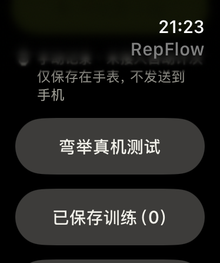
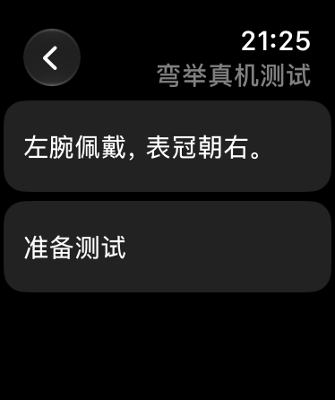

# 弯举计次准确率报告与标注数据集说明

评估日期：2026-11-22。关联 [#110](https://github.com/Team-Party-A/repflow/issues/110)。
算法采用 [#109 合入 dev 的版本](https://github.com/Team-Party-A/repflow/commit/6fca6b5f0040e84464d2db06f1d87b605786fec6)。

## 数据集与次数依据

首批采集由 3 人完成，每人每动作录 3 组。28 份导出 JSON 经 [v1.0 检查器](../../ml/inspect_recording.py)验证通过，其中有 1 份字节一致的重复导出，按录制编号去重后为 27 组。

| 动作 | 独立录制 | 本报告使用范围 |
| --- | ---: | --- |
| 哑铃弯举 | 9 | 逐组计次回放 |
| 哑铃肩推 | 9 | 首批数据集说明 |
| 持哑铃深蹲 | 9 | 首批数据集说明 |

采集时按下开始、结束记录有效组区间。作者确认每组观察到 10 次，次数按录制编号记在[首批采集清单](../data/首批采集清单.csv)。本报告用该清单作为整组人工确认次数的来源。原 JSON 的 `annotations` 均为空，`set.ground_truth_count` 保留为 `null`。若后续补录逐次完成时刻，使用单独标注副本并依[格式 v1.0](../data/01-sensor-recording-format.md)核对。当前参与者到文件的逐段映射未确认，报告只给出组级结果。

原始 JSON 与私有核对表由采集负责人保存在本机仓库外的文稿「软件工程」目录。团队复核可由采集负责人提供授权访问。仓库内保存[匿名采集清单与标注说明](../data/首批采集与标注.md)。

## 回放方法

按 `recording_id` 对齐仓库清单和私有核对表，选择全部 9 组弯举，按原始顺序仅输入 `set.start_s` 到 `set.end_s` 内的样本。每组新建计次器，使用当前合入版本的默认参数。人工次数只用于结果比较。按[设计文档](../design/概要设计-算法.md#弯举计次规则与开发回放)保留左腕、表冠朝右的设备轴序与符号。

实际回放编译 [Swift 计次器](../../apps/apple/Shared/CurlRepCounter.swift)，用[对照测试中的回放入口](../../ml/test_curl_rep_counter.py)与 [Python 参考实现](../../ml/curl_rep_counter.py)比对。9 组共 8,079 条组内样本，累计次数及缺口数逐条一致。各组实际采样率约 49.883–49.887 Hz，计次器报告缺口均为 0。原始文件的 SHA-256 在回放前后保持一致。

## 逐组结果

录制编号使用首批采集清单中唯一的 8 位前缀。差值为预测次数减去人工确认次数。

| 录制编号 | Swift 预测次数 | 人工确认次数 | 差值 | 绝对误差 |
| --- | ---: | ---: | ---: | ---: |
| `03891867` | 10 | 10 | 0 | 0 |
| `2c0a1d66` | 10 | 10 | 0 | 0 |
| `3e4cefe5` | 10 | 10 | 0 | 0 |
| `5f67eec8` | 10 | 10 | 0 | 0 |
| `65eb335b` | 8 | 10 | −2 | 2 |
| `82acd957` | 10 | 10 | 0 | 0 |
| `b166fb73` | 10 | 10 | 0 | 0 |
| `c010ecf5` | 10 | 10 | 0 | 0 |
| `ec5f6a82` | 10 | 10 | 0 | 0 |

预测合计 **88 次**，人工确认合计 **90 次**。整组完全一致 **8/9**（88.9%），绝对误差不超过 1 次 **8/9**（88.9%），平均绝对误差 **0.22 次/组**，最大绝对误差 **2 次**。

## 误差案例 `65eb335b`

该组人工确认 10 次，Swift 和 Python 均确认 8 次。有效组约为 3.751–15.733 秒，最大相邻采样间隔 0.020048 秒，计次器记录 0 个采样缺口。

| 位置 | 回放证据与可能影响 |
| --- | --- |
| 组首 | 首个组内样本的有符号角速度为 −3.03 rad/s，计次器等待角速度回到安静范围，约 4.170 秒才进入待触发状态。诊断时纳入组前样本后，额外识别出一个跨越组首的周期候选。 |
| 组尾 | 约 15.216 秒打开最后一个候选，组内未观察到平滑角速度反向。诊断时延伸至录制末尾，候选最大积分回程约 30.6%，仍低于 70% 和 85% 的确认门槛。 |

诊断过程仅检查组边界附近的信号，逐组汇总仍采用原始有效组边界。人工记录仅有整组次数，两个候选的观察用于解释算法为何未计，具体对应哪两次人工动作待逐次观察记录验证。

## 真机观察

采集负责人在 Apple Watch Series 10 上运行使用同一 Swift 计次器的本地测试版（构建号 3），报告连续弯举时存在漏计，并观察到屏幕显示 1 次。现场记录缺少该组的人工总数和原始传感器序列，暂无法计算该组误差或定位漏计原因。这项现场观察单列，前述指标仍以首批 9 组的离线回放为准。

以下是本地测试版在 Apple Watch 模拟器上的操作界面。打开 RepFlow 后，点「弯举真机测试」进入准备页。实际计次观察来自上面的 Series 10 真机测试。

| RepFlow 首页的测试入口 | 点进测试后的准备页 |
| --- | --- |
|  |  |

## 结果适用范围

这 9 组全部为左腕、表冠朝右，且参与了 #109 规则选择。结果描述首批开发数据上的整组误差。换腕、反向表冠、不同组次数和实时连续弯举的稳定性需另有实测证据。现有人工总数只支持组级比较，逐次误报、漏报和确认延迟需有对齐后的逐次事件才能计算。

## 结论

首批 9 组弯举中，8 组的计次与人工次数一致，只有 1 组少计 2 次。我本人佩戴手表测试过，观察到连续弯举时存在漏计。
