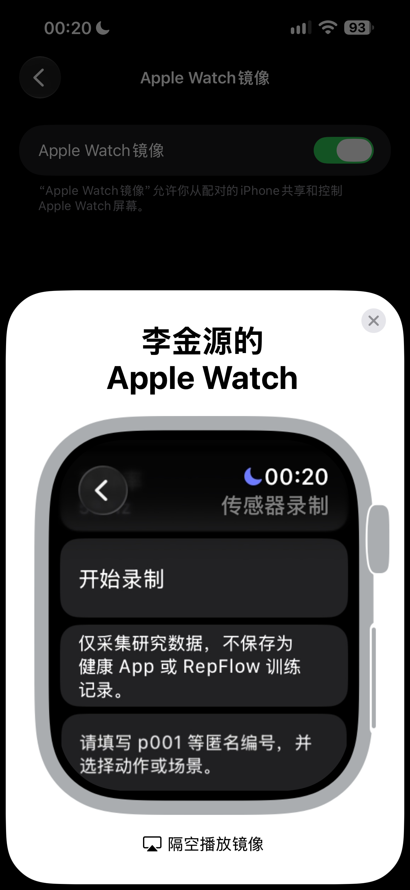
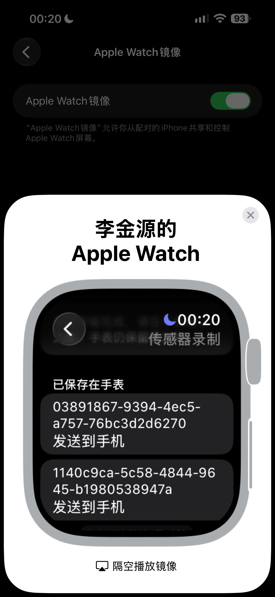
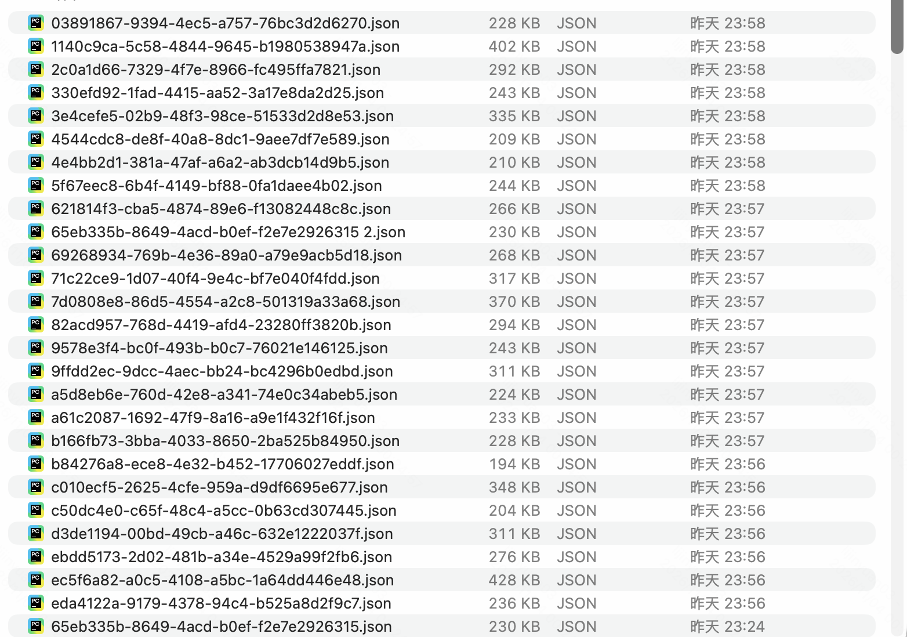

# 首批数据采集与标注

更新：2026-11-04；关联 [#74](https://github.com/Team-Party-A/repflow/issues/74)。本说明配合[录制工具](../../apps/apple/README.md)与[格式 v1.0](01-sensor-recording-format.md)使用。

## 1. 采集安排

本批按作者确认的安排组织：3 个动作 × 3 名参与者 × 每人每动作 3 组，计划共 **27 组**。每个动作按相同的三名参与者顺序依次各录 3 组，再换动作；作者确认各组观察次数为 10 次。计划数量与实际通过核对的独立片段分开统计。

| 动作编号 | 动作 | 用途 |
| --- | --- | --- |
| `dumbbell_curl` | 哑铃弯举 | 首批自动计次评估 |
| `dumbbell_shoulder_press` | 哑铃肩推 | 首批自动计次评估 |
| `dumbbell_squat` | 持哑铃深蹲 | 验证腕部信号，暂不作为自动计次支持承诺 |

先用一组弯举试走完整流程，检查通过且标注方式可用后再录其余各组。每个动作的三组建议覆盖不同次数，如 4/8/12 次，实际次数由独立观察记录；参与者按可完成的轻负荷、自然节奏录制。不要将目标次数输入算法或直接当作真值。

动作顺序和组次数的顺序在参与者间轮换，记录实际佩戴腕、表冠方向、设备及系统。静止、走动、拿放器械等负样本，以及短组、半次、停顿样本可后续补充，单独建清单，不计入 27 个标准动作组。

## 2. 私有目录与采集记录

开始前确认团队使用的私有网盘目录、可访问成员及保留期。匿名编号由组织采集者分配，身份对应表另行保管。参与者只通过团队约定方式交文件，不把原始 JSON 或视频发到 PR、Git 或 AI 对话中。

建议私有目录使用 `raw/`、`annotated/`、`checks/` 与 `observations/`：原始文件不覆盖，标注副本沿用同一录制编号，检查统计和观察依据分开保存。

私有采集登记表每段一行，字段如下。仓库附[首批采集清单](首批采集清单.csv)，按真实录制编号列出 27 段独立录制的动作、作者确认次数与逐段采样检查结果。参与者映射和事件标注未完成时显式标记 `pending`，不猜填编号。第 6 节提供汇总。

| 字段 | 填写内容 |
| --- | --- |
| 计划位置 | 匿名编号、动作、该动作第几组 |
| 录制编号 | 导出文件内 `recording_id`，不是计划位置编号 |
| 设备与佩戴 | 型号、实际系统、佩戴腕、表冠方向、采样率 |
| 动作过程 | 实际观察次数、停顿、半次或中断情况 |
| 观察依据 | 独立观察记录或私有视频编号；标注及复核日期 |
| 检查与状态 | 检查器退出码、是否已标注/复核、可用或剔除及原因 |

仓库保存本说明及匿名录制清单与质检汇总。真实填写的登记表与逐段检查结果放私有目录。

## 3. 先试录一组

1. 安装最新 dev 的双端 App，先打开配对手机；手表填分配的匿名号，选择哑铃弯举及 50 Hz。
2. 开始录制，等样本数增长，静止约 3 秒后点“开始本组”。独立观察者记录动作过程；若使用视频，事先取得参与者同意并拍到必要动作及时间对齐依据。
3. 完成动作并回到起始姿态，点“结束本组”；静止约 3 秒后停止保存。真机试录包含落腕熄屏，脱离 Xcode 调试器执行。
4. 手机收到对应 UUID 的文件后，通过系统分享导出到电脑私有目录，保留手表原文件用于重发。
5. 在仓库根目录本地运行：

   ```sh
   python3 ml/inspect_recording.py "/私有目录/raw/录制编号.json"
   ```

6. 退出码为 0 后，核对 `data_kind=recorded`、设备信息、有效采样率、最大样本间隔、`tail_gap_s` 和有效组边界。结合观察记录判断缺口是否影响该组，登记可用或剔除原因。
7. 按下一节完成标注，再运行同一检查器验证标注副本。一组完整走通后，继续其余计划位置。

检查器通过表示格式符合要求；平均频率正常仍需查看最大间隔及尾部间隔。没有自动采用的丢帧阈值，首次试录先保留实际结果供采样质检确认。

## 4. 标注步骤

将原始文件复制到 `annotated/`，只修改 `set` 与 `annotations`，保留样本、录制编号和元信息。录制工具已记录有效组的开始、结束；先核对这两个边界是否对应实际动作段。

每次从约定起始姿态出发、完成动作并返回该姿态，标一个 `rep_complete` 完成时刻。首批双侧同步动作按完整周期一次；暂停、半次和不确定区间按以下规则单列。

| type | 时间字段 | 如何处理 |
| --- | --- | --- |
| `rep_complete` | `t_s` | 完整一次的返回时刻，位于有效组内且不重复 |
| `pause` | `start_s`、`end_s`、`reason` | 停顿保留在原时间轴，不另开组 |
| `incomplete` | `start_s`、`end_s`、`reason` | 未完成周期，在有效组内，不计完整次 |
| `ambiguous` | `start_s`、`end_s`、`reason` | 无法确认真值的区间，留待复核 |

`annotations` 按事件时间或区间起点排序，区间采用左闭右开。完整事件不放在暂停、半次或不确定区间内。`reason` 使用场景类别，如“遮挡无法确认回位”，不填写个人信息。

**视频时间对齐：** 同时记录视频中“开始本组”的可见操作时刻及 JSON 的 `set.start_s`，作为对齐锚点。事件换算为 `t_s = 视频事件秒数 - 视频锚点秒数 + set.start_s`，再用“结束本组”与 `set.end_s` 复核对齐偏差，并记录人工操作和视频帧率带来的时间不确定性。若没有可靠锚点，先补对齐依据或重录，不把视频秒数直接填入 JSON。仅有口头总数也不足以填写逐次事件时间。

完整复核且组内没有 `ambiguous` 时，将 `ground_truth_count` 填为 `rep_complete` 的数量；其余情况保持 `null`。不要拿目标次数、算法结果或用户组后修正值补真值。已有明确事件可以保留，但不确定组不参与整组误差统计。

补标完成后本地运行：

```sh
python3 ml/inspect_recording.py "/私有目录/annotated/录制编号.json"
```

## 5. 汇总与交付

按动作与匿名参与者统计计划、实际录制、检查通过、真值复核完成及剔除的组数；未完成位置继续留空。说明剔除原因、实际设备及佩戴覆盖，并单列额外的负样本和特殊场景。

本 Issue 的完成依据为 27 组实际采集与标注、文件检查通过，以及数据说明和标注规则经 PR 合入。说明与采集清单不能代替私有原始文件和人工复核；当前交付状态见第 6 节。原始数据及带真实记录的登记表保留在私有网盘，仓库提交匿名汇总和本说明。

## 6. 首批导出检查（2026-11-04）

作者确认已由三人轮换完成录制，每人每个动作三组、每组观察次数为 10。以下为本地导出文件的实际检查结果，不将口头总数或算法预测补造为逐次完成事件。

| 项目 | 本轮检查结果 |
| --- | --- |
| 导出文件 | 28 个 JSON，均通过现有格式检查器 |
| 独立片段 | 27 个录制编号；其中两份导出文件的编号和完整字节内容均相同，重复副本只计入文件数 |
| 按动作去重 | 哑铃弯举 9 段、哑铃肩推 9 段、持哑铃深蹲 9 段 |
| 实际采样率 | 约 49.883–49.887 Hz |
| 最大相邻样本间隔 | 约 0.020048 秒；仅表示本批观察到的结果，不作为新增验收阈值 |
| 参与者编号 | 作者确认换动作时才修改编号；原文件编号与动作对应，不能据此作三名参与者的分层评估 |
| 次数依据 | 作者确认每组做 10 次；独立观察总数记录与逐次事件标注分开保存 |
| 标注状态 | 原始文件均为 `annotations=[]`、`ground_truth_count=null`；逐次完成时刻尚未补标 |

待交付闭环：依据可靠录制顺序核对参与者与文件映射、完成标注及本人复核，再对标注副本运行检查器。导出文件的添加时间中有多个相同时间值，不能仅据文件添加时间自动分配参与者。原始文件不改写、不删除；更正编号仅作用于有明确映射依据的标注副本，并保留更正记录。

当前数据存于本机下载目录（仓库外）；团队私有网盘、访问范围及保留期尚待确认。未完成上述事项前，本批可用于输入和采样流程检查，不作为完整验收或正式按参与者评估的依据。


### 验证依据

采集清单每行对应一个真实 `recording_id`，去重后共 27 行，包含每段样本数、时长、有效采样率、最大样本间隔、尾部间隔和格式检查结论。`observed_count=10` 的来源为作者确认，不表示逐次事件已标注；参与者映射及事件标注均保留待完成状态。清单按动作与录制编号排序，行号不表示录制先后。

复核成员可在获得授权的私有数据目录逐段运行 `python3 ml/inspect_recording.py <文件路径>`，将输出与清单按录制编号核对。下列作者提供的真机截图记录录制入口、手表本地保存及电脑导出列表；截图不替代 JSON 检查和人工标注。仓库不包含原始传感器样本、视频或私有下载链接。


### 真机操作截图

录制入口：通过 iPhone 的 Apple Watch 镜像查看真实手表，界面显示“开始录制”及研究数据用途说明。



手表本地保存：列表显示已保存的录制编号及“发送到手机”操作；此图只证明手表保留了文件，不单独证明手机已持久化接收。



电脑导出：Finder 中的 JSON 文件列表。列表包含重复导出副本，截图中的排列及添加时间不用于推断参与者或真实录制顺序；27 段独立录制的数量以清单及编号、内容去重检查为依据。


