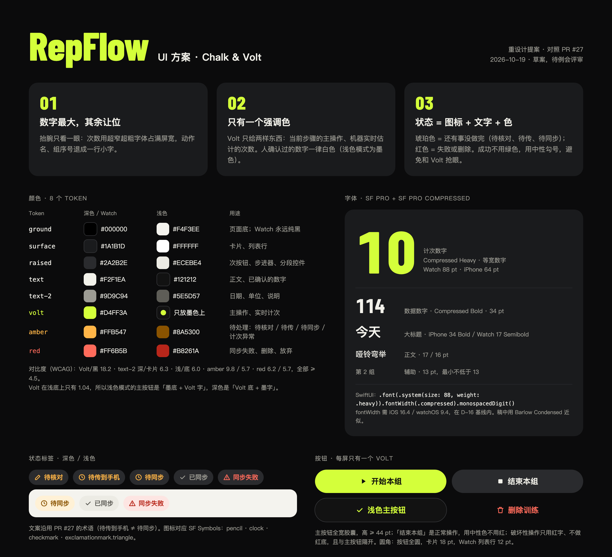
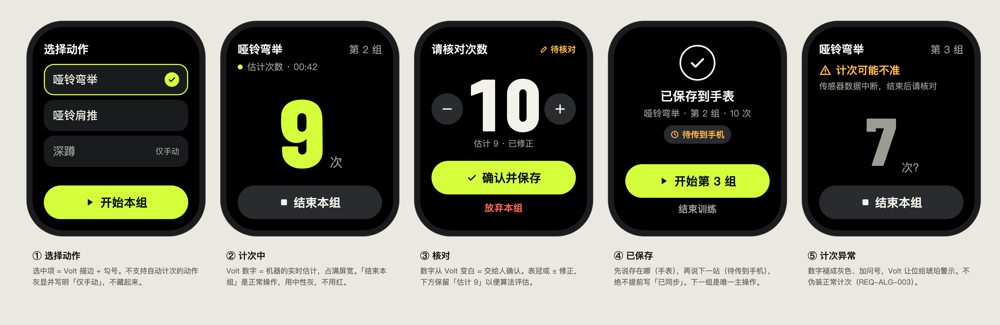
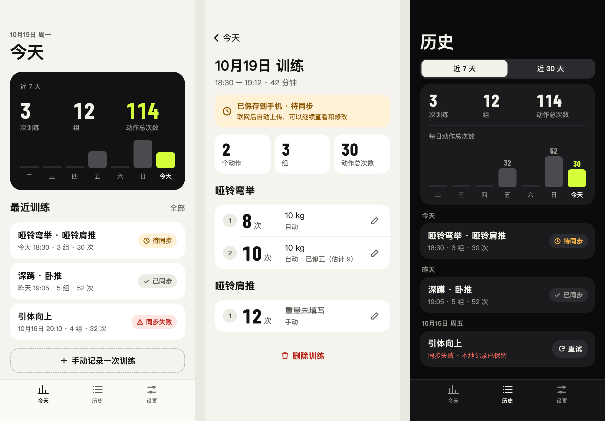

# RepFlow UI 规范

版本：v0.2 评审稿；日期：2026-10-19；负责人：whj（@whj-thu）；视觉方案：Wensharre（@wenshare71）。关联任务：[#11](https://github.com/Team-Party-A/repflow/issues/11)。配套文档：[术语表](术语表.md)。

v0.2 相对 v0.1：视觉层（颜色、字体、按钮、图标的视觉规则）换成「Chalk & Volt」方案；状态文案、术语、需求追溯沿用 v0.1。全部取值仍是评审提案，未经真机验证。

## 1. 设计方向：Chalk & Volt

黑底、粉笔白、一个荧光强调色（Volt）。训练时用户只会抬腕看一眼，所以界面围绕「次数」这一个数字组织。

| 原则 | 含义 |
| --- | --- |
| 数字最大，其余让位 | 次数用超窄超粗的数字字体占满 Watch 屏宽；动作名、组序号退成一行小字。 |
| 只有一个强调色 | Volt 只用在两处：当前步骤的主操作、机器实时估计的次数。人确认过的数字一律用正文色。 |
| 状态 = 图标 + 文字 + 色 | 琥珀色表示还有事没做完（待核对、待传、待同步、计次异常），红色表示失败或删除。成功不用绿色，用中性色勾号，避免和 Volt 抢眼。 |

范围约束（沿用 v0.1）：

- Must 流程：选择动作 → 开始本组 → 自动计次 → 结束本组 → 核对／修正 → 确认并本地保存 → 后续同步。
- 组间休息自动识别、训练模板是 Should，自动识别动作是 Could。UI 不暗示这些能力已完成，也不展示心率、热量、恢复评分等没有承诺的内容。
- 兼容基线沿用 REQ-NFR-001：iOS 17.2.1、watchOS 9.6.3。本稿用到的 API 都在基线内（见 3.1）。
- iPhone 跟随系统浅色／深色；Watch 只做深色。

原型稿见 [ui-main.html](../assets/ui-main.html)、[ui-watch.html](../assets/ui-watch.html)、[ui-phone-today.html](../assets/ui-phone-today.html)、[ui-phone-detail.html](../assets/ui-phone-detail.html)、[ui-phone-history.html](../assets/ui-phone-history.html)，用浏览器直接打开；截图见第 6 节。



## 2. 颜色

### 2.1 色板（8 个 token）

| Token | 深色／Watch | 浅色 | 用途 |
| --- | --- | --- | --- |
| `ground` | `#000000`（Watch）／`#0B0B0C`（iOS） | `#F4F3EE` | 页面底；Watch 永远纯黑 |
| `surface` | `#1A1B1D` | `#FFFFFF` | 卡片、列表行 |
| `raised` | `#2A2B2E` | `#ECEBE4` | 次按钮、步进器、分段控件、状态标签底 |
| `text` | `#F2F1EA` | `#121212` | 正文、已确认的数字 |
| `text2` | `#9D9C94` | `#5E5D57` | 日期、单位、说明 |
| `volt` | `#D4FF3A` | 只放在墨色（`#121212`）上 | 主操作、实时计次 |
| `amber` | `#FFB547` | `#8A5300`（标签底 `#FFF1D6`） | 待核对、待传到手机、待同步、计次异常 |
| `red` | `#FF6B5B` | `#B8261A`（标签底 `#FDE5E2`） | 同步失败、删除、放弃 |

实现时在 Asset Catalog 里按 token 名建 Color Set，分别填浅色、深色值；代码只引用 token 名，不写死十六进制。

### 2.2 对比度

按 WCAG 计算：Volt／黑 18.2:1；`text2` 深色在 `surface` 上 6.3:1，浅色在 `ground` 上 6.0:1；`amber` 9.8:1／5.7:1；`red` 6.2:1／5.7:1。文字全部 ≥ 4.5:1。

Volt 和浅色底只有 1.04:1，所以：

- 浅色模式的主按钮是「墨色底 + Volt 字」，深色和 Watch 是「Volt 底 + 墨色字」。
- 浅色模式下 Volt 不做文字色，也不直接放在浅色底上；只在墨色卡片（如首页统计卡）内部使用。

### 2.3 颜色怎么用

- 一屏最多一个 Volt 主按钮。
- 计次中的数字是 Volt（机器估计）；进入核对后变成 `text`（交给人确认）；采样异常时褪成 `text2` 并加问号。
- 「结束本组」是正常操作，用 `raised` 中性色，不用红。
- 破坏性操作（删除训练、放弃本组）只用红字，不做红底，并和主按钮隔开。
- 任何状态都同时有图标和文字，不能只靠颜色或圆点。

## 3. 字体、数字与布局

### 3.1 字体

只用系统字体，不引入第三方字体。数字用 SF Pro 的 Compressed 宽度：

```swift
Text("\(repCount)")
    .font(.system(size: 88, weight: .heavy))
    .fontWidth(.compressed)
    .monospacedDigit()
```

`fontWidth(_:)` 需要 iOS 16.4／watchOS 9.4，在基线内。原型稿用 Google Fonts 的 Barlow Condensed 近似 SF Pro Compressed，仅供预览，App 里不用。

| 用途 | Watch | iPhone | 字重与说明 |
| --- | --- | --- | --- |
| 计次数字 | 88 pt | 64 pt | Compressed Heavy，等宽数字 |
| 数据数字 | 34 pt | 34 pt | Compressed Bold；统计卡、组记录里的次数 |
| 大标题 | 17 pt | 34 pt | Watch Semibold，iPhone Bold |
| 正文、按钮 | 16 pt | 17 pt | Regular／Semibold |
| 辅助 | 13 pt | 13 pt | Regular；最小不低于 13 pt |

- 计次数字已经占满屏宽，不跟随动态字体放大；其余文字用系统语义样式（`.title`、`.body`、`.footnote` 等），跟随动态字体。
- 计次数字要检查 `0`、`9`、`10`、`100` 在 41 mm 和 45 mm 表盘上的排版，示例数值不代表次数上限。
- 大字号下优先换行或滚动，不截断动作名、状态和主操作。

### 3.2 间距、圆角与触控

- iPhone 页面左右边距 20 pt；间距用 4／8／12／16／24 pt。
- 圆角：按钮全圆（胶囊），卡片 18 pt，Watch 列表行 12 pt，统计大卡 24 pt。
- 主按钮全宽、高 ≥ 44 pt；Watch 的 ± 按钮直径 ≥ 37 pt（原型 56 px ÷ 1.5）。
- 核心操作都有可见按钮，表冠、滑动、长按只作补充。

### 3.3 数值、单位和时间（沿用 v0.1）

| 内容 | 显示约定 |
| --- | --- |
| 次数／组数 | `10 次`、`3 组`；整数，不省略单位。 |
| 统计 | `3 次训练 · 12 组 · 动作总次数 114`；手机与 Web 同一口径。原型统计范围写「近 7 天」，避开周起点未定的问题。 |
| 重量 | 带单位；未填写显示「重量未填写」或「—」，不显示 `0 kg`。kg 与单侧口径待评审。 |
| 日期 | 列表用「今天 18:30」「昨天 19:05」「10月16日」；详情给完整时间段，如 `18:30 – 19:12 · 42 分钟`。 |
| 休息时长 | `01:30`，并写明「已休息」或「剩余休息」；方向、起点、默认值待确认。 |

## 4. 组件

| 组件 | 规则 | 两端适配 |
| --- | --- | --- |
| 主按钮 | 每屏一个；Volt 胶囊，左侧带图标；提交中防重复点击。 | Watch 全宽贴底；iPhone 浅色用墨色底 + Volt 字。 |
| 次按钮 | `raised` 底 + `text` 字，例如「结束本组」「重试」。 | 同上。 |
| 文字按钮 | 无底色；破坏性用 `red`，普通用 `text2`，例如「放弃本组」「结束训练」。 | 放在主按钮下方，留出间隔。 |
| 动作选择项 | `surface` 行；选中项 = 2 pt Volt 描边 + Volt 勾号；不支持自动计次的动作灰显并写「仅手动」，不隐藏。 | Watch 列表；iPhone 手动记录时复用。 |
| 次数显示 | 动作名 + 组序号一行小字，数字居中占满宽度，旁边写「次」；计次中显示「估计次数」和已用时间。 | Watch 主屏；iPhone 记录详情用 34 pt 版本。 |
| 次数修正 | 数字两侧 ± 圆形按钮，下方保留「估计 9 · 已修正」，方便算法评估。 | Watch ± 加表冠；iPhone 点铅笔进入编辑。 |
| 状态标签 | 胶囊，图标 + 文字；深色用 `raised` 底，浅色用对应浅底（见 2.1）。 | 两端同一套文案与图标。 |
| 同步横幅 | 详情页顶部，琥珀或红色浅底，标题 + 一行说明。 | 仅 iPhone。 |
| 组记录行 | 序号圆点、次数（34 pt）、重量、来源（自动／自动 · 已修正／手动）、编辑按钮。 | 仅 iPhone。 |
| 统计卡 | 三个数字（训练、组、动作总次数）+ 7 天柱状图；今天用 Volt，其他天用灰色，无数据的天画 4 pt 短线。 | iPhone 首页（墨色卡）、历史页（`surface` 卡）。 |
| 分段控件 | `raised` 底，选中段 `text` 底 + 反色字。 | 仅 iPhone。 |
| 确认弹窗 | 写明对象、影响、取消和具体操作，例如「保留」「放弃本组」。 | 用系统弹窗；删除用系统破坏性样式。 |
| 休息计时（Should） | 写明计时含义，可人工纠正；确认次数不重置已开始的休息。 | 交互待 #19 和算法评审。 |

## 5. 图标

用 SF Symbols，单色，字重跟随旁边文字；两端同一含义用同一符号。原型稿里的线条图标只是占位。

| 含义 | SF Symbol | 配套文字 |
| --- | --- | --- |
| 开始本组／开始下一组 | `play.fill` | 开始本组、开始第 3 组 |
| 结束本组 | `stop.fill` | 结束本组 |
| 确认、已保存、已同步 | `checkmark` | 确认并保存、已保存到手表、已同步 |
| 待核对、修正 | `pencil` | 待核对、修正第 N 组 |
| 待传到手机、待同步 | `clock` | 待传到手机、待同步 |
| 同步失败、计次异常 | `exclamationmark.triangle` | 同步失败、计次可能不准 |
| 重试 | `arrow.clockwise` | 重试 |
| 增减次数 | `plus`／`minus` | 辅助功能标签写「增加 1 次」「减少 1 次」 |
| 删除 | `trash` | 删除训练 |
| Tab：今天／历史／设置 | `chart.bar`／`list.bullet`／`slider.horizontal.3` | 今天、历史、设置 |

图标按钮必须有辅助功能标签；VoiceOver 读作「哑铃弯举，估计次数 9 次」。计次数字变化不逐次打断朗读。

## 6. 关键屏幕

### 6.1 Watch：一组的完整流程



| 屏幕 | 要点 |
| --- | --- |
| ① 选择动作 | 选中项 Volt 描边 + 勾号；唯一主操作「开始本组」。 |
| ② 计次中 | Volt 数字是实时估计；「结束本组」用中性灰。 |
| ③ 核对 | 数字变白，表示交给人确认；± 或表冠修正；主操作「确认并保存」，下方红字「放弃本组」。 |
| ④ 已保存 | 先写保存位置（已保存到手表），再写下一站（待传到手机），不写「已同步」；主操作「开始第 N 组」。 |
| ⑤ 计次异常 | 琥珀警示 + 一句原因，数字褪成灰色加问号，不伪装正常计次。 |

原型按 45 mm（198 × 242 pt）的 1.5 倍绘制；41 mm 需另外检查。

### 6.2 iPhone：今天、训练详情、历史



| 屏幕 | 要点 |
| --- | --- |
| 今天（浅色） | 墨色统计卡：近 7 天训练、组、动作总次数，今天的柱子和动作总次数用 Volt；最近训练列表带同步标签；虚线框「手动记录一次训练」。 |
| 训练详情（浅色） | 顶部同步横幅；三格摘要；按动作分组的组记录行；底部红字「删除训练」。 |
| 历史（深色） | 近 7 天／近 30 天分段；统计卡 + 每日柱状图；按日期分组的列表，同步失败行带「重试」按钮。 |

## 7. 状态文案（沿用 v0.1）

### 7.1 Watch：组的完成与交接

| 场景 | 文案 | 操作与边界 |
| --- | --- | --- |
| 已选择受支持动作 | `哑铃弯举` | 主操作「开始本组」。 |
| 不支持自动计次的动作 | `深蹲` · `仅手动` | 灰显，不隐藏。 |
| 正在计次 | `估计次数 · 00:42`，数字 `9 次` | 主操作「结束本组」；新增计次只算本组。 |
| 结束组、待核对 | `请核对次数` · `待核对` | 可修正；「确认并保存」／「放弃本组」。 |
| 放弃未确认组 | `放弃本组？本组尚未保存，其他已保存的组不受影响。` | 「继续核对」／「放弃本组」。 |
| 本地保存成功 | `已保存到手表` · `待传到手机` | 具体补发与接收确认由 #19 定义。 |
| 本地保存失败 | `本组尚未保存，请重试` | 保留当前输入，不显示成功。 |
| 采样异常 | `计次可能不准` · `传感器数据中断，结束后请核对` | 可核对或结束，已确认组保留。 |
| 回放验证 | `回放验证 · 不计入训练记录` | 验证界面持续显示，不进真实历史。 |

只凭 Watch 发出消息不能显示「已同步」。手机接收成功的判断依赖后续契约。

### 7.2 iPhone：账号、记录与上传

| 场景 | 文案 | 操作与边界 |
| --- | --- | --- |
| 待同步 | `已保存到手机 · 待同步`，说明 `联网后自动上传，可以继续查看和修改` | 可查看和编辑；上传中可临时显示「正在上传」。 |
| 已同步 | `已同步` | 只对应当前修改获得后端确认；再次修改回到待同步。 |
| 同步失败 | `同步失败 · 本地记录已保留` | 提供「重试」；认证或输入错误给出对应操作。 |
| 登录失效 | `登录已失效，请重新登录后继续同步` | 提供「重新登录」；不写成网络错误。 |
| 无记录 | `还没有训练记录` | 提供「手动记录一次训练」；不显示报错。 |
| 加载失败 | `暂时无法加载，请重试` | 展示的缓存数据注明范围和更新时间。 |
| 次数非法 | `请输入有效的整数次数` | iOS 手动记录拒绝 0、负数和非整数；Watch 0 次组待评审。 |
| 重量非法 | `重量不能小于 0` | 保留输入；空值允许保存。 |
| 删除训练 | `删除这次训练？它将从历史和统计中移除，删除结果会同步到后端。` | 「取消」／「删除训练」。 |
| 有待上传记录时退出 | `还有 N 条记录未上传，仍要退出登录吗？` | 「取消」／「退出登录」；数据保留或清除待 Q3 确认。 |

不向用户展示 API 路径、异常堆栈、token 或内部状态值。

## 8. 需求追溯

| 本稿约定 | 依据 |
| --- | --- |
| 估计／最终次数、结束后核对、只改当前组、重复确认不新增组 | [04-alg-web.md](../requirements/04-alg-web.md) 第 2.1 节、REQ-ALG-001、002 |
| 采样异常可见、休息识别不阻塞人工流程、回放隔离 | 同上 REQ-ALG-003、004、REQ-NFR-406 |
| 记录项、输入规则、删除确认、历史与统计 | [01-ios.md](../requirements/01-ios.md) REQ-IOS-003–009 |
| 三种同步状态、登录失效、退出前提示 | 同上 REQ-IOS-002、011；[03-backend.md](../requirements/03-backend.md) REQ-BE-007 |
| 保存和同步分开、最终次数、删除传播 | REQ-BE-004–007；[竞品分析](../requirements/竞品分析.md) |
| 色板、字体、组件、图标、屏幕布局 | 本稿 v0.2 视觉提案，待两端评审 |

## 9. 待决问题

- **视觉方向**：v0.2 把 v0.1 的系统蓝换成 Chalk & Volt，影响 iOS 和 watchOS 两端，需要两端负责人（iOS @wenshare71、watchOS @whj-thu）都同意。
- **Volt 色值**：`#D4FF3A` 在户外强光下的可读性要在真机上看；备选 `#7CF0C5`（薄荷）、`#FF8A3D`（橙）。
- **需求评审**：0 次组和空训练、重量单位／精度／单侧口径、休息计时起点和方向、统计周起点和时区、退出后的数据保留。
- **#19 对齐**：手表传输确认、结束训练时未确认组的处理、保存失败的恢复。

原型／实现走查清单（本次未执行）：

- [ ] 默认与大字号、浅色与深色、41 mm 与 45 mm 下，动作、次数、错误信息和主按钮都可读、可点。
- [ ] 状态不只靠颜色；按钮与次数有辅助功能标签；开启减少动态效果时不丢信息。
- [ ] 估计 9 次改为 10 次后只保存一份，前一组不变，重复确认不新增记录。
- [ ] 待核对、待传到手机、待同步、同步失败可以区分；断网不显示记录丢失。
- [ ] 回放与模板不进入真实统计；重试和刷新不重复累加。

参考：[Apple HIG：Accessibility](https://developer.apple.com/design/human-interface-guidelines/accessibility)、[Typography](https://developer.apple.com/design/human-interface-guidelines/typography)、[Designing for watchOS](https://developer.apple.com/design/human-interface-guidelines/designing-for-watchos)。

v0.1 由 Codex 协助起草；v0.2 视觉方案由 Claude Code 协助起草。团队审查、批准与真机验证仍待完成。
