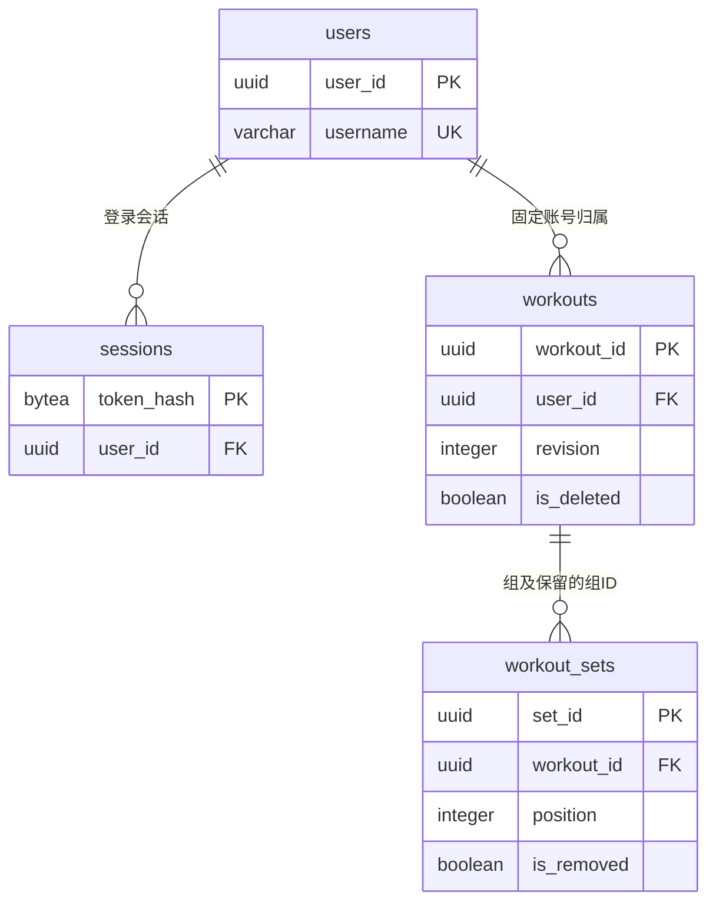
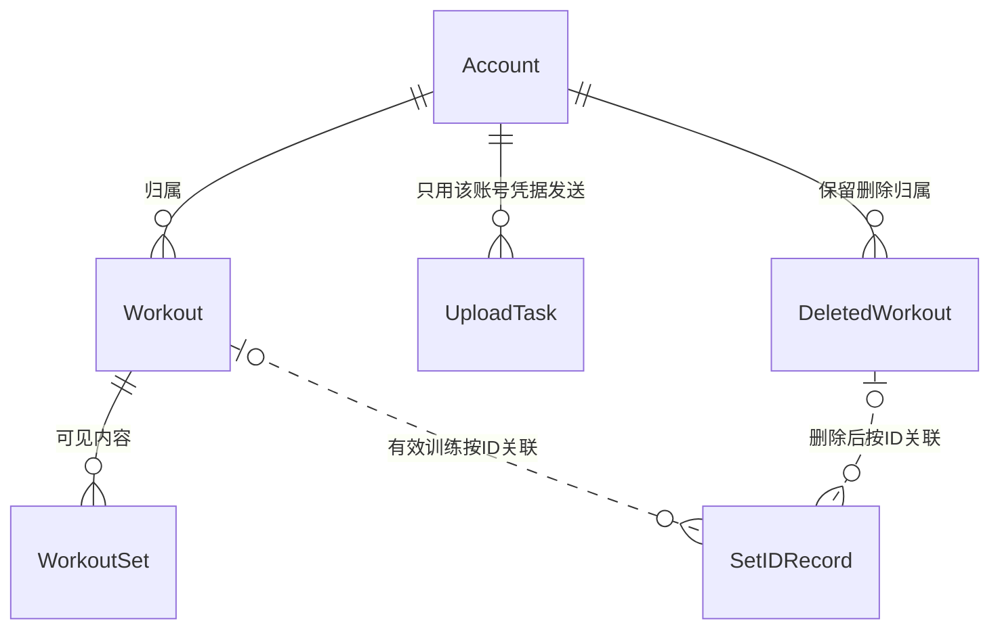

# 数据库设计与 iOS 本地模型对齐（#57）

状态：后端负责人已 review，待 iOS 核对字段映射及 IOS-02 后共同定稿；2026-11-01；后端 @hulaoyagg、iOS @wenshare71；目标截止 11-01。

## 1. 范围与依据

本稿基于 `dev 6648084`、[OpenAPI 1.0.0](../api/openapi.yaml)、[手表消息 v1](../data/02-watch-phone-messages.md)及 [iOS 在 #57 的确认](https://github.com/Team-Party-A/repflow/issues/57#issuecomment-6498869005)。账号模型、动作清单已由 #76、#75 合入；已核对 #77 的 [iOS 章节](概要设计-iOS.md)、#81 的[概要设计总览](概要设计.md)及 #80 的[测试计划](../testing/测试计划.md)。本稿供 #62 后端接口与 #65 iOS 数据层共同评审。

只交付文档和 ER 图；不执行迁移，不改业务代码、冻结契约、客户端或服务器。服务端沿用 PostgreSQL 18.6／SQLAlchemy／Alembic；iOS 已选择 SwiftData，token 单独放 Keychain。双端字段按职责映射，不要求逐列相同。

## 2. 服务端 ER 图与已有账号表

图中允许训练关联零个组 ID，因为未知 ID 的 DELETE 也须落库；**有效训练仍必须有 1–1000 个有效组**。删除行仅保留识别、归属及版本信息，详见第 3 节。

以下沿用 [账号与会话设计](账号与会话设计.md)及现有 `0001_accounts` 迁移，不重新选型：

| 表／字段 | 类型与空值 | 用途／约束 |
| --- | --- | --- |
| `users.user_id` | UUID，非空 PK | 后端生成 UUIDv4；重登不变，对应 `AuthResult.user_id` |
| `users.username` | VARCHAR(32)，非空 UNIQUE | 小写保存；数据库检查 `[a-z0-9_]{3,32}` |
| `users.password_hash` | TEXT，非空 | 完整 Argon2id 哈希，不存密码明文 |
| `users.created_at` | TIMESTAMPTZ，非空 | 后端生成的注册时间，不新增 API 字段 |
| `sessions.token_hash` | BYTEA，非空 PK | SHA-256 摘要，长度 32 字节；不存原 token |
| `sessions.user_id` | UUID，非空 FK → users | 登录会话归属 |
| `sessions.issued_at / expires_at` | TIMESTAMPTZ，非空 | 后端业务保证固定 365×24 小时，不续期 |
| `sessions.revoked_at` | TIMESTAMPTZ，可空 | null 表示未撤销；在线退出仅撤销当前会话 |

`Credentials.password` 只参与哈希校验；`AuthResult.access_token` 只交付客户端并存 Keychain，`token_type` 固定 Bearer，不另建数据库列。

## 3. 新增训练与组表（提案）

### 3.1 workouts

| 字段 | PostgreSQL 类型 | 约束与映射 |
| --- | --- | --- |
| `workout_id` | UUID，非空 PK | 手机／手表 UUIDv4；全局唯一，沿用路径和响应 ID |
| `user_id` | UUID，非空 FK → users | 从认证会话取得；首次绑定后不变，不接受上传指定 |
| `revision` | INTEGER，非空 | 1–2147483647；对应请求版本与成功回执 `accepted_revision` |
| `is_deleted` | BOOLEAN，非空 | 内部删除标记；回执 `deleted` 由它生成 |
| `record_kind` | TEXT，可空 | 有效行必为 `actual`；删除行清空 |
| `started_at` | TIMESTAMPTZ(6)，可空 | 有效行必填，映射 UTC 事件时刻；删除行清空 |
| `ended_at` | TIMESTAMPTZ(6)，可空 | 有效行 null 表示尚未结束／未知；非空须 ≥ started_at；删除行清空 |
| `time_zone` | VARCHAR(64)，可空 | 有效行必填、1–64 字符，有效 IANA 标识；删除行清空 |

有效／删除两种行形态用 CHECK 约束区分，显式检查 NULL，不能让“必填条件计算为 NULL”绕过检查。删除行保留前四列，因而无需伪造未知训练的开始时间。`TIMESTAMPTZ` 不保留原 IANA 名称，须另外保存 `time_zone`；输出统一 UTC、`Z`、至多微秒。[PostgreSQL 时间说明](https://www.postgresql.org/docs/18/datatype-datetime.html#DATATYPE-DATETIME-INPUT)

### 3.2 workout_sets

| 字段 | PostgreSQL 类型 | 约束与映射 |
| --- | --- | --- |
| `set_id` | UUID，非空 PK | 全局唯一；即使删组／删训练也保留 |
| `workout_id` | UUID，非空 FK → workouts | 组的固定归属，不能转给其他训练 |
| `is_removed` | BOOLEAN，非空 | 内部标记；true 时仅保留前三列 |
| `position` | INTEGER，可空 | 有效组为 1–1000，对应 `sets` 数组位置；不作为 HTTP 字段 |
| `exercise_id` | VARCHAR(64)，可空 | 有效组必填，格式 `^[a-z][a-z0-9_]*$`；应用校验共享名单 |
| `final_rep_count` | INTEGER，可空 | 有效组必填，1–9999；统计采用此值 |
| `estimated_rep_count` | INTEGER，可空 | automatic 必填且为 0–2147483647；manual 必须 null |
| `record_source` | TEXT，可空 | 有效组必为 automatic／manual；修正次数不改变 automatic |
| `weight_grams` | INTEGER，可空 | 0–1000000；null 未填，0 明确零负重，不互相替换 |

规则与索引：

- 有效组的必填、范围及来源／估计值组合由 CHECK 检查；移除行的内容列全部 NULL。外键不级联物理删除，一期无账号物理删除或删除标记清理接口。
- `user_id`／组的 `workout_id` 仅首次写入，后续更新排除归属列并做冲突检查；外键保证引用存在，不代替账号授权或归属不可变的业务校验。
- `UNIQUE(workout_id, position)` 防止有效位置重复；使用 PostgreSQL 默认 NULL 可重复语义，让多个已移除组保留 ID。重排时在同一事务内先将旧组置为完整的移除形态（标记移除、清空位置及内容），再按新数组恢复有效组；不能只清空位置而违反有效行 CHECK。提交前完成恢复，对外没有中间状态。
- `workouts(user_id, started_at DESC, workout_id DESC) WHERE NOT is_deleted` 服务账号隔离与分页；组表上述唯一索引也支持按训练读取／排序，不再重复建索引。
- UUIDv4、IANA 名称、共享动作、单次 1–1000 组及连续数组顺序由请求校验和写入事务保证。普通 CHECK 不负责跨行计数或查询其他表。[PostgreSQL 约束说明](https://www.postgresql.org/docs/18/ddl-constraints.html)
- 不保存额外请求 JSON 或摘要；同版本比较从当前字段及组顺序还原的完整 `WorkoutInput`，不比较内部标记或其他运维字段；比较先于任何写入。取舍见 [ADR 0003](../adr/0003-workout-storage.md)。

## 4. 写入、读取与失败边界

### 4.1 同一事务完成版本判断与整条替换

1. 鉴权并校验输入；跨账号训练或组统一 404，权限检查先于返回版本或删除状态。
2. 写入采用 READ COMMITTED。对新训练先尝试 `INSERT … ON CONFLICT(workout_id) DO NOTHING`，记录是否本事务新建；随后锁定对应训练行 `FOR UPDATE`。不能只锁查询结果，否则两个首次请求都可能看到“不存在”。
3. 对已有行按下表处理。同版本同内容直接成功，不清组、不改版本。对要接收的组，按固定 ID 顺序登记／核验归属；依靠 `set_id` 主键处理并发争用，不仅靠事前查询。同账号其他训练的组为 409，其他账号为 404；失败回滚本次新登记。
4. 更大版本在同一事务内更新训练、组内容与顺序，并将缺失旧组标为移除；DELETE 清空内容、保留训练和已有组 ID。请求中任何一组失败，都回滚全部内容、ID 登记及版本。
5. 提交成功后才返回 `workout_id / accepted_revision / deleted`。并发组登记发现新的跨账号归属时仍先返回 404；数据库暂时失败按契约返回 503，不伪装成业务版本冲突。

| 当前状态 | 请求 | 结果 |
| --- | --- | --- |
| 不存在 | 合法 PUT，任意合法 revision | 创建训练和全部组，200／deleted=false |
| 不存在 | 合法 DELETE | 创建该账号的删除标记，200／deleted=true |
| 有效记录 | PUT 更大版本 | 完整替换，200 |
| 有效记录 | PUT 同版本同规范化内容 | 200，不重写 |
| 有效记录 | PUT 更小版本／同版本不同内容 | 409，返回当前版本 |
| 有效记录 | DELETE 更大版本 | 保留删除标记，200；同版本或更小版本为 409 |
| 已删除 | 任意合法 PUT | 410，不因更大版本恢复 |
| 已删除 | DELETE 同版本／更大版本／更小版本 | 分别为 200 幂等／200 推进删除版本／409 |

规范化比较覆盖所有请求字段：对象键顺序忽略，UUID 转小写，时间按 UTC 时刻比较，`time_zone` 保留字符串含义；`sets` 顺序必须一致，null 与 0 不同。删除后重新记录使用新训练 ID；组 ID 的永久归属不等于新增“同一有效训练永远不能再次包含该 ID”的契约限制。

### 4.2 查询与统计

查询始终限定会话 `user_id`、有效训练及有效组。建议在**同一个只读 REPEATABLE READ 事务**内先分页训练，再加载其组，避免并发替换时读到旧 revision 配新组；这不提供跨页快照。[PostgreSQL 隔离级别](https://www.postgresql.org/docs/18/transaction-iso.html)

按 `(started_at DESC, workout_id DESC)` 排序，组按 position 还原数组。游标携带账号、原时间筛选与上次排序位置，校验不匹配为 422；其编码不新增表，也不充当授权凭据。`limit / cursor / started_from / started_before`、返回 `items / next_cursor` 均为查询控制，不是业务列。

时间范围为开始时刻的左闭右开区间；统计按手机当前时区、周一起算本周／本月，再换算 UTC 边界。仅计有效实际训练；动作筛选只汇总命中组、训练去重。次数／组数等由记录计算，不另存容易失真的计数；分页查询必须取齐范围才能汇总。

## 5. iOS 本地模型与映射

以 iOS 已确认的六类实体为基线；删除与组 ID 标记永久保留已在 iOS 章节第 3、6 节确认。下表新增元数据的具体落点见 IOS-02，待共同 review。类型为逻辑类型，`?` 表示可空；SwiftData 具体声明与事务实现由 iOS 负责。

| 实体 | 字段与类型 | 持久化／映射规则 |
| --- | --- | --- |
| Account | `user_id: UUID`，`username: String` | user_id 唯一；来自 AuthResult；退出不删除账号记录 |
| Workout | `workout_id: UUID`、`user_id: UUID`、`revision: Int32`；开始／结束 `Date / Date?`；`time_zone: String`；`record_kind=actual` | 对应服务端训练字段；user_id 只决定本地隔离与使用哪个 token，不上传 |
| Workout（本地元数据） | 创建来源（手表／手机）、同步状态；建议 `confirmed_revision: Int32?`、`end_handoff_received: Bool` | 创建来源不替代组 record_source；已结束、已交接、已同步是不同状态 |
| WorkoutSet | `set_id: UUID`、所属训练、`position: Int`；动作 `String`、最终次数 `Int`、估计值 `Int?`、来源枚举、重量 `Int?` | 对应六个 WorkoutSet 字段；按 position 序列化为数组，不上传 position |
| WorkoutSet（仅本地） | `set_started_at / set_ended_at: Date?`；建议 `watch_set_index: Int?` | 未知时间保持 null；手机手动组无手表索引；首次接收用于排序，与可编辑 position 分开 |
| UploadTask | `(user_id, workout_id, revision)` 唯一；类型 PUT／DELETE；`request_snapshot: Data?`；任务状态、重试次数、最近错误码 | PUT 保存完整不可变 WorkoutInput；DELETE 无正文，保存 ID／revision 即可；不存 token、密码或错误请求原文 |
| DeletedWorkout | `workout_id: UUID` 唯一、`user_id: UUID`、删除 revision；建议确认版本 `Int32?`、结束交接标记 `Bool` | 保留归属与删除事实；确认后可释放删除任务和内容，最小删除标记不自动过期 |
| SetIDRecord | `set_id: UUID` 唯一 → `workout_id: UUID` | 永久保留接收／终止处理的 ID；删除内容不级联删除此记录，不存原始消息快照 |

虚线是逻辑 ID 关联，不表示对可见 Workout 的级联删除外键。UploadTask 也不能随可见训练删除而消失；同一 workout_id 的归属可从 Workout 或 DeletedWorkout 找到，二者转换必须原子完成。

本地事务和回执规则：

- 保存／编辑时，一次事务写内容、新 revision 与请求快照；相同 revision 重试只发送原快照。纯同步状态、重复消息和 ack 不推进版本。空草稿不上传、不计历史统计，至少一组确认后才形成训练。
- 同一 `(user_id, workout_id)` 串行发送；不同训练可并行。只有当前登录账号匹配任务归属才发送；离线或 token 过期保留本地数据，同账号重登续传。已知 A 的手表训练在 B 登录时仍归 A、B 不可见；未登录不保存、不 ack。
- 成功回执要匹配任务账号、workout_id、accepted_revision **和 deleted 类型**。旧回执只完成旧任务；确认版本不倒退，只有当前内容版本已确认才显示已同步。网络失败保留快照；401 挂起待重登，409／422／410 按契约处理，不盲目加版本重试。
- 删除或删最后一组时，原子保存删除标记、递增 revision 与 DELETE 任务；即使从未上传也发送 DELETE。未发出的旧 PUT 可取消；在途 PUT 的晚到回执不能取消 DELETE 或恢复内容。
- 收组时同一事务保存归属、内容、SetIDRecord 和待上传快照，成功才 ack。重复组仅按 ID 确认处理；已删除训练的新晚到合法组只登记终止处理后 ack。首次结束保存独立交接标记；删除后仍保留该标记，重复结束不能覆盖编辑。未知训练／缺组标记的结束不建空记录、不 ack；完成结束交接后的未知手表组也不接收，已知组仍可 ack。

动作使用 [共享 ExerciseCatalog](../../apps/apple/Shared/Exercise.swift)：

| exercise_id | weight_grams 的含义 |
| --- | --- |
| dumbbell_curl、dumbbell_shoulder_press、dumbbell_squat | 单只哑铃重量，两手各一只不翻倍 |
| bench_press、deadlift | 杠铃含杠总重 |
| pull_up、push_up | 自重外额外负重；徒手为 0 |

UI 按已确认的 `round(kg × 1000)` 存整数克，建议用十进制量化避免边界浮点误差；未填为 null，超范围不截断。手表 v1 只发送 automatic 组且重量为 null；#70 的手表手动页面当前仅本地保存、不发送训练消息，见[watchOS 章节](概要设计-watchOS.md)。手表手动组后续如何同步另行对齐，不据共享代码注释扩展契约；手机仍可手动记录全部动作。本次不新增动作业务表或数据库枚举类型。

## 6. 后续实现验收样例

下表为 #62／#65 及联调的测试计划，**不是已执行结果**；业务迁移和数据库测试在实现任务开展。

| 场景 | 必须验证的结果 |
| --- | --- |
| 手动两动作三组 | 手动估计值为 null；数组顺序、重量 null／0 保持，汇总三组 |
| 自动估计 9，修正为 10 | estimated=9、final=10、source=automatic；统计用 10 |
| 断网编辑、token 过期后同账号重登 | 内容和任务不丢；原版本原快照补传 |
| A 退出、B 登录及旧回执晚到 | A 数据对 B 不可见、不以 B 上传；回执只作用于 A 原任务 |
| 未登录收组后登录 | 前者不保存、不 ack；retry_pending 后按契约补发 |
| 上传 v2 途中编辑到 v3 | v2 成功不能清掉 v3；杀进程重启后待办仍在 |
| 两个首次 PUT／PUT 与未知 ID DELETE 并发 | ID 只有一个账号归属，事务顺序决定合法结果，无部分记录 |
| 同版本改变键顺序／UUID 大小写／时间小数写法 | 规范化等价为 200；换组顺序、改次数或 null→0 为 409 |
| 更新中任意一组非法或 ID 冲突 | 整条回滚，不消耗 revision、不遗留新 ID 占用；跨账号不泄露版本 |
| 交换组位置、删组后复用 ID | 重排不违反 CHECK／唯一约束，提交后内容完整；同一有效训练可重新包含原组 ID，跨训练复用 409、跨账号 404 |
| 删除前 PUT 超时、DELETE 先到，随后旧／更高版本 PUT | 仍为删除状态，合法 PUT 均 410；重复 DELETE 及新旧版本按状态表处理 |
| 删除已获后端确认后，手表组／结束重放 | 不恢复、不重新归属；已处理标记仍能支持正确 ack |
| 结束 ack 丢失，用户编辑或删除后重复结束 | 独立交接标记拦截覆盖；未知训练或缺组标记不 ack |
| 并发替换时分页查询、相同开始时刻、夏令时边界 | 单次响应训练与组一致；ID 次序稳定；跨页无快照承诺，统计按日历范围取齐 |

## 7. 对齐状态与合入条件

| 编号 | 结论／待确认内容 | 状态与责任 |
| --- | --- | --- |
| DB-01 | 两张关系表同时保留最小删除行和组 ID；查询过滤标记，删除行不会自动清理。取舍见 ADR 0003 | 后端已 review；iOS 在本 PR 核对接口映射 |
| IOS-01 | DeletedWorkout、SetIDRecord 不过期、退出不清；后端确认后可释放任务／正文，不删除最小标记 | 已由 #77 iOS 章节第 3、6 节确认，不再重复等待 |
| IOS-02 | 建议 Workout／DeletedWorkout 持久化 `end_handoff_received`；确认版本用 `confirmed_revision`（或由持久化任务等价表达）；首次手表序号用 `watch_set_index`，与可编辑 position 分开。字段只存手机 | 请 iOS 确认采用这些落点，或提供保证相同行为的字段映射；后端共同核对 |

结束、删除与去重行为已经由冻结契约要求；IOS-02 只确认怎样持久化，不重新决定是否支持。iOS 共同审查字段映射并确认 IOS-02 后，补入确认记录再合入；#57 由 PR 的 `Closes #57` 自动关闭。

定稿后 #62 编写迁移及接口、#65 实现本地模型与事务；后续测试按第 6 节及统一测试计划执行。本稿不改变契约，也不代表业务实现、迁移或真机验收完成。

由 Codex 协助起草；会话：RepFlow #57 数据库设计与 iOS 本地模型对齐。
