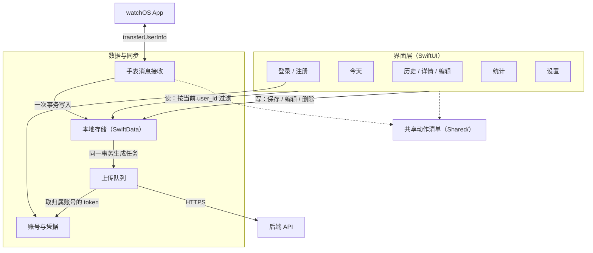

# RepFlow 概要设计：iOS 章节（评审草稿）

版本：v0.1；日期：2026-10-30；章节负责人：Wensharre（@wenshare71）。关联 #64，供 #68 汇总。

本章描述 iOS App 的模块划分，以及它与后端、手表的边界。字段、错误码和消息语义以契约为准，本章只写 iOS 怎么组织、谁负责什么；系统总览和两条关键数据流见[概要设计总览](概要设计.md)第 2、4 节，这里不重复画。

## 1. 依据与当前状态

| 依据 | 本章引用的内容 |
| --- | --- |
| [iOS 需求](../requirements/01-ios.md) | REQ-IOS-001–012、REQ-NFR-101、102 |
| [OpenAPI 1.0.0](../api/openapi.yaml) | 账号接口、训练 PUT / DELETE、`revision` 与 `accepted_revision` |
| [手表与手机消息格式 v1](../data/02-watch-phone-messages.md) | 手机接收事务、归属、去重、结束消息、`retry_pending` |
| [ADR 0001](../adr/0001-backend-stack.md) | token 固定 365 天、只撤销当前会话 |
| [UI 规范](UI规范.md)、[iOS 原型](../prototype/ios.html) | 页面、组件与状态文案 |
| [共享动作清单](../../apps/apple/Shared/Exercise.swift) | `exercise_id`、是否自动计次、重量口径 |
| #57 中 iOS 负责人的答复 | 本地实体草图，A3 以此为输入 |

当前状态：

- **已交付**：Xcode 工程骨架（iOS 与 watchOS 两个 target）、可交互原型、共享动作清单。
- **待实现**：本章所有模块。B4（本地数据层）、B5（登录对接）、B7（上传）按本章划分开工。
- **不新增依赖**：存储用 SwiftData，网络用 URLSession，凭据用 Keychain，手表通信用 WatchConnectivity，都是系统框架。

## 2. 模块划分

| 模块 | 职责 | 不负责 | 对应需求 |
| --- | --- | --- | --- |
| 界面 | 登录注册、今天、历史、训练详情与编辑、手动记录、统计、设置；显示同步状态 | 不直接发请求，不直接处理手表消息 | 001、004–010、012 |
| 账号与凭据 | 注册、登录、退出；token 按 `user_id` 存 Keychain；维护「当前登录账号」 | 不保存密码 | 001、002、NFR-102 |
| 本地存储 | 训练、组、删除标记、组 ID 登记、上传任务的持久化；所有写操作在一次事务内完成 | 不判断网络和登录状态 | 003–007、NFR-101 |
| 上传队列 | 按任务发送 PUT / DELETE，处理回执和错误，更新同步状态 | 不修改训练内容，不推进 `revision` | 011、002.2、002.5 |
| 手表消息接收 | 解析 `set_saved`、`workout_ended`，校验、去重、归属，持久化后回 `ack`；登录后发 `retry_pending` | 不上传，不等待后端 | 003 |

共享动作清单放在 `Shared/`，两个 target 共用同一份源码，不经消息或接口下发。

## 3. 本地存储

实体与 #57 答复中的草图一致，A3 只对齐上传字段，不要求和服务端表逐列对应。

| 实体 | 用途 | 生命周期 |
| --- | --- | --- |
| Account | 本机登录过的账号（`user_id`、用户名），token 不在此表 | 退出不删 |
| Workout | 训练内容、归属 `user_id`、`revision`、来源、同步状态 | 用户删除时移除，改留删除标记 |
| WorkoutSet | 组内容，含只存手机的组开始 / 结束时刻和顺序 | 随训练或单组删除 |
| UploadTask | 待发送的 PUT / DELETE，含当次请求快照和重试信息 | 回执确认后删除 |
| DeletedWorkout | 删除标记，阻止旧补发和旧请求恢复记录 | 不过期，退出不清 |
| SetIDRecord | `set_id` → `workout_id` 登记，供手表去重 | 不过期，退出不清 |

几条贯穿全局的规则：

1. **一次写入，一个事务。** 改训练内容时，内容、新 `revision`、上传任务在同一事务提交；`revision` 只在内容真正变化时加 1。
2. **快照发送。** 上传任务保存当次请求体，重试只发快照，同一 `revision` 不会发出两种内容。
3. **按账号隔离。** 界面和统计只读当前登录账号的数据；其他账号的记录留在本机、不展示、不以当前账号身份上传。
4. **组时间只存手机。** `set_started_at`、`set_ended_at` 用于详情展示，不上传；上传时组的顺序由 `sets` 数组表达。

统计按手机当前时区、周一起算，只统计实际记录（REQ-IOS-009）；草稿和未确认的组不计入。

## 4. 与后端的边界

上传队列是 iOS 唯一访问后端的模块，界面不直接发请求。

| 事件 | iOS 的处理 |
| --- | --- |
| 保存、编辑训练 | 生成 PUT 任务；至少一组已确认记录才上传，空草稿只留本地 |
| 删除训练、删除最后一组 | 生成 DELETE 任务并写删除标记；未上传过的训练也发送 DELETE |
| 收到成功回执 | `accepted_revision` 等于任务的 `revision` 才完成任务；本地已有更高版本时训练保持「待同步」 |
| 网络错误、超时、5xx | 保留任务，有上限地退避重试，状态显示「同步失败」并提供重试 |
| 401 | 停用该账号的 token，提示重新登录；同账号登录后继续发送 |
| 409、410、422 | 按[总览第 4.3 节](概要设计.md#43-失败与恢复)处理，不抬高 `revision` 强行覆盖 |

- 同一训练的任务串行发送，不同训练可以并行；任务只用归属账号的 token。
- 触发时机：保存后立即尝试、App 回到前台、登录成功、用户点重试。一期不做后台定时上传。
- 后端地址由不入库的 `.xcconfig` 注入（REQ-NFR-102.3）。
- 本期只上传，不从后端拉取，也不做多设备合并。

## 5. 与手表的边界

手表消息接收模块按消息契约第 3.2、3.3 节实现，这里只写 iOS 侧的分工。

- **ack 的含义**：手机本地事务提交成功后才回 `ack`，与后端是否上传无关。写入失败、未登录、协议错误都不回。
- **归属**：先查本机已有的训练归属和删除标记；查不到时，新训练归当前登录账号，绑定和写入在同一事务。
- **去重**：用 SetIDRecord 判断重复组；重复消息直接回 `ack`，不覆盖手机上的编辑，也不恢复已删除的记录。
- **结束消息**：写入 `ended_at` 并推进 `revision`；手表清单不覆盖手机上的编辑、删组或手动加的组。
- **补发**：登录成功、WatchConnectivity 重新激活时发一条 `retry_pending`；手表负责检查发件箱。
- **重量**：手表 v1 不传重量（`weight_grams` 为 null），由手机补填；之后的旧补发不会覆盖手机补填的值。

## 6. 对后端章节待确认项的答复

**A2-BE-01：iOS 页面与本地模型；账号、revision、上传及删除任务的持久化。**
页面以已合入的原型为准，覆盖一期需要的数据；原型中的「近 7 天 / 近 30 天」统计已过时，实现按本周 / 本月。本地模型见第 3 节，持久化规则在 #57 已逐项答复：内容、`revision` 与上传任务同事务写入；任务按 `(user_id, workout_id)` 串行；删除标记和组 ID 登记永久保留。页面上需要保存而接口未表达的只有组时间和同步状态，都只存手机，不需要改契约。A3 可以据此设计业务表。

**A2-BE-03：A1 动作清单、自动计次范围及重量含义。**
动作清单已由 #75 合入 `Shared/Exercise.swift`，iOS 以它为唯一来源：

- 动作键只用清单中的 `id`；收到清单中没有的 `exercise_id` 时，保留记录并提示更新 App，不猜名称。
- 重量口径按清单中每个动作的 `load`：哑铃动作记单只重量，杠铃动作记含杠总重，自重动作记额外负重。界面按 kg 输入，保存为 `weight_grams = round(kg × 1000)`；不填存 null，填 0 存 0。
- 自动计次范围（`isAutoCounted`）只影响手表；手机上所有动作都能手动记录。自动计次范围的调整由手表和算法负责人决定。

## 7. 本章待确认

| 编号 | 内容 | 相关负责人 |
| --- | --- | --- |
| A2-IOS-01 | 上传退避的次数与间隔；同步时延在配对真机联调时实测 | iOS |
| A2-IOS-02 | 训练模板（Should）是否同步到手表、是否上传后端 | iOS、watchOS |
| A2-IOS-03 | 后端地址切换到 HTTPS 的时间点，作为登录联调的前提（对应 A2-BE-04） | iOS、后端 |
