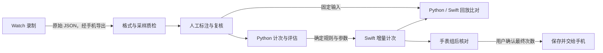

# RepFlow 概要设计：算法章节

版本：v0.1；日期：2026-10-31。关联 [#72](https://github.com/Team-Party-A/repflow/issues/72)，供 [#68](https://github.com/Team-Party-A/repflow/issues/68) 汇总。

系统架构、部署图与跨端业务数据流统一见[概要设计总览](概要设计.md)。

本章描述传感器录制、人工标注、Python 离线评估与 Swift 手表端计次的衔接。采用已知动作、手动开组与结束组的流程，首选有符号轴信号、因果移动平均、峰值候选和完整周期校验。

## 1. 依据与当前状态

| 依据 | 本章使用的内容 |
| --- | --- |
| [算法需求](../requirements/04-alg-web.md) | REQ-ALG-001–003、REQ-NFR-403–406：组内计次、核对修正、异常提示与可复现评估 |
| [计次可行性调研](../algorithm/计次可行性调研.md) | 首选方法、采集标注口径、按人隔离评估及降级方案 |
| [录制数据格式 v1.0](../data/01-sensor-recording-format.md) | 原始样本、时间、单位、组边界和人工真值 |
| [共享动作清单](../../apps/apple/Shared/Exercise.swift) | 稳定动作编号与自动计次范围 |
| [手表与手机消息格式 v1](../data/02-watch-phone-messages.md) | 原始估计、最终次数与记录来源的交接 |
| [录制与导出说明](../../apps/apple/README.md) | 手表录制、手机接收、电脑导出与格式检查步骤 |

已交付录制格式、离线检查器及录制导出工具。基线算法与评估脚本由 [#73](https://github.com/Team-Party-A/repflow/issues/73) 实现，首批采集与标注由 [#74](https://github.com/Team-Party-A/repflow/issues/74) 推进。本章确定设计；算法误差与运行性能由后续实测给出。

## 2. 动作范围与整体流程

| 动作编号 | 动作 | 本阶段用途 |
| --- | --- | --- |
| `dumbbell_curl` | 哑铃弯举 | 首批自动计次动作，采集与评估 |
| `dumbbell_shoulder_press` | 哑铃肩推 | 首批自动计次动作，采集与评估 |
| `dumbbell_squat` | 持哑铃深蹲 | 采集验证腕部信号，暂不开启自动计次 |

范围沿用 #63 / #75 共享清单。前两项的自动计次配置表示实现范围，准确性仍需独立评估；深蹲是否纳入自动计次，待采集结果评审后决定。



## 3. 录制与标注

录制流程使用现有工具：选择匿名编号、动作或负样本场景及请求采样率，录制准备段、有效组和组后静止段，再经手机导出到电脑。首轮请求 50 Hz，25 Hz 用于对照；实际频率和采样缺口由真实时间戳统计。

| 环节 | 输入 | 输出 |
| --- | --- | --- |
| 录制 | 动作或场景、匿名编号、设备与佩戴配置、Core Motion 样本 | 一段一个 v1.0 JSON，包含原始三轴、相对时间及元信息 |
| 质检 | 原始 JSON、采集过程记录 | 检查器结果、可用片段清单及剔除原因 |
| 标注 | 录制片段、独立观察记录或对齐后的视频 | 有效组边界、完整次事件、暂停、半次和不确定区间 |
| 复核 | 标注与原始观察依据 | 已确认真值、仍无法确认的区间及复核记录 |

样本保留 API 的轴顺序、符号、单位和实际间隔。首个有效样本为零点，组边界及全部标注使用同一时间轴。原始样本保留不变，标注结果另存为可追溯副本，再用现有检查器校验。

完整一次按“从约定起始姿态出发、完成动作并返回起始姿态”标记；首批双侧同步动作以完整周期计一次。暂停和半次分别标注，无法确定的区间标为 `ambiguous`。未完成总数复核或组内存在不确定区间时，`ground_truth_count` 保持 `null`，不参与整组计次误差统计。

人工真值独立于算法预测和用户组后修正。正样本、负样本及短组、停顿、半次等边界样本分别统计。首批起步采集按 #74 的 3 个动作、3 名参与者、每人每动作 3 组执行；报告使用实际可用数量，后续扩大样本按调研计划补齐覆盖。

原始录制、标注副本及观察视频保存在仓库外的私有目录。仓库保存数据说明、标注规则和汇总结果；采集前确认访问范围与保留期。

## 4. 离线计次与评估

### 4.1 首选计次流程

Python 读取检查通过的文件，按有效组边界逐样本运行以下流程：

1. **选信号**：用开发集比较用户加速度与角速度的各条有符号轴，为每个动作选择稳定信号。
2. **因果平滑**：移动平均只使用当前及此前样本。沿用调研约 0.10 秒的试验初值，具体窗口依据采样间隔与开发集结果确定。
3. **候选检测**：结合幅度、最小峰间隔和局部回落找出候选峰。
4. **完整周期校验**：记录出发、候选与回位阶段，完成一轮才累计一次。短暂停顿保持当前阶段；新组开始时清空缓存、阶段和次数。
5. **输出事件**：记录动作完成时刻、结果确认时刻及当前累计次数。结束组后停止接收新增样本，并按同一组尾规则完成结果，不把未完成周期补为一次。

动作轴、幅度、最小峰间隔、窗口与组尾规则随开发集实验确定，评估前固定。自相关用于离线节奏对照；首选信号不适用时再评估双阈值状态机。当前方法不引入第三方依赖，也不预先规定缺少观测依据的阈值。

### 4.2 评估产物

| 产物 | 内容 |
| --- | --- |
| 每段计次结果 | 录制编号、动作、参数版本、原始估计总数、动作完成与结果确认事件 |
| 标准组误差 | 估计总数与人工真值的绝对误差、MAE、误差不超过 1 次的组占比及最坏组 |
| 事件指标 | 预测与人工完成事件一对一匹配，报告漏计、重复计次、precision 和 recall |
| 负样本与特殊场景 | 分场景误计总数及每分钟误计；短组、暂停和半次另列结果 |
| 延迟与失败分析 | 动作完成到结果确认的延迟分布、异常片段及失败原因 |

采用按人留一评估：两人的数据用于信号与参数选择，第三人留出测试，轮换三次。同一段数据及其切窗始终在同一侧。事件匹配容差也由开发集确定，测试前固定。样本规模不足时报告现有结果与缺少的覆盖，不将初步试验作为最终泛化结论。

报告按动作、参与者和组长分层列出样本量，说明剔除项。不确定真值单列；事件指标分母为零时记为 N/A。误差门槛按[统一需求第 3 节](../requirements/需求规格说明书.md)的实测评审流程定稿，算法准确率报告在检查 3（12 月 3 日）前完成。

## 5. 手表端推理与记录交接

Swift 使用与 Python 一致的逐样本规则，为当前已选动作维护按时间淘汰的采样窗口、周期阶段和估计次数。首版接收相对时间与三轴运动信号，输出累计估计与采样缺口数。

手表在用户开组后开始计次。结束时冻结本组估计，交给核对界面；用户确认后，按现有消息契约保留 `estimated_rep_count`、`final_rep_count` 和 `record_source`，由手表保存并交接给手机。算法只提供估计，账号、消息发送和后端上传沿用双端既有流程。

采样异常时停止用异常样本累加并提示核对，已有确认记录保留；需要判断持续中断时，阈值经采样实测确定。自动休息识别按 Should 留待后续，当前以手动开组、结束与核对走通计次流程。

回放使用固定片段和同一组参数逐样本输入 Python 和 Swift，比对累计次数、采样缺口数与组尾结果。后续评估按独立真值核对动作完成时刻与结果确认延迟。手表接入后再验证真机现场动作与落腕持续采样。

### 哑铃弯举计次模块接口

[#109](https://github.com/Team-Party-A/repflow/issues/109) 在 `apps/apple/Shared/CurlRepCounter.swift` 提供纯 Swift 计次器。手表训练页接入见 [#123](https://github.com/Team-Party-A/repflow/issues/123)。调用方按组持有计次器，并在同一执行上下文中依次执行下列操作。

| 接口 | 行为 |
| --- | --- |
| `CurlRepCounter()` | 新建可接收样本的组，次数与采样缺口数均为 0。 |
| `mutating func append(_ sample: Sample)` | 喂入一条包含时间戳、三轴去重力加速度、三轴角速度和三轴重力向量的样本。保留设备坐标系下的轴顺序和符号，由模块选择计次信号。时间戳使用组内同一单调时间轴上的秒数，可从任意非负值开始。忽略非有限、负时间、重复或倒序样本。 |
| `count: Int`（只读） | 读取已确认的累计估计次数，开组和采样过程中均可读取。 |
| `gapCount: Int`（只读） | 读取组内检测到的采样缺口数。检测到缺口时清除未确认的周期，保留已确认次数。调用方可用此值提示用户核对。 |
| `mutating func finish() -> Int` | 冻结并返回本组估计。组尾未完成的周期不加一，结束后的迟到样本不再更新状态。重复调用返回同一结果。 |
| `mutating func reset()` | 清空计次、缺口、时间和平滑状态，开始接收下一组样本。 |

`CurlRepCounter.Sample` 使用 `Double` 保存时间戳，其余三项均为 `SIMD3<Double>`。字段和单位与录制格式对应。

```swift
var counter = CurlRepCounter()
counter.append(.init(
    timestamp: timestamp,
    userAccelerationG: acceleration,
    rotationRateRadS: rotationRate,
    gravityG: gravity
))
let currentEstimate = counter.count
let finalEstimate = counter.finish()
counter.reset()
```

真机采样和回放均可传同一形式的样本。手表接入层停止采样并隔离上一组回调后，再重置模块开始下一组。采样权限、采样不可用和持续无样本的提示由接入层处理。模块本身不依赖 CoreMotion、HealthKit 或界面，也不改变录制与消息格式。

### 弯举计次规则与开发回放

弯举使用 `-rotationRateRadS.y` 的 0.20 秒因果移动平均，按实际采样间隔积分。原型在抬起后停住的合成样本上误计 1 次，因此新规则要求观察到反向运动与足够的回程。

| 阶段 | 判定与参数依据 |
| --- | --- |
| 准备 | 开组或缺口后等到平滑角速度的绝对值降至 0.20 rad/s，避免从半次运动开始就建立候选。相邻有效样本间隔大于 0.20 秒时清空窗口和候选。 |
| 抬起 | 正向角速度越过 0.20 rad/s 后开始积分。候选至少达到 1.50 rad/s 和 0.45 rad 的估计抬起幅度，过滤小幅短脉冲。0.20 秒、0.20 rad/s 和 1.50 rad/s 沿用原型。 |
| 放下 | 必须出现反向角速度，积分回程达到峰值幅度的 85% 后计次。若回程达到 70%，且当前重力方向与起始重力方向的余弦相似度至少 0.90（夹角约 26°），可提早确认。开发回放选用相对回程比例以适应不同幅度，重力为辅助证据。 |
| 确认 | 两次确认至少间隔 0.90 秒，沿用原型的防重复设置。结束时冻结已确认次数。 |

9 组手表开发录制均为左腕同一表冠配置，核对表每组为 10 次。回放比较如下。

| 信号与规则 | MAE（次） | 误差不超过 1 次 |
| --- | ---: | ---: |
| 角速度积分回程与重力辅助 | 0.22 | 8/9 |
| 原型角速度负 Y 轴 | 0.44 | 8/9 |
| 去重力加速度负 Z 轴 | 0.33 | 9/9 |
| 去重力加速度投影到重力方向 | 1.11 | 7/9 |
| 前 3 秒选择重力主轴并检测转折点 | 2.33 | 5/9 |
| 原型角速度加重力幅度和加速度活动门槛 | 0.44 | 8/9 |

[LEAN 论文](https://pmc.ncbi.nlm.nih.gov/articles/PMC10222347/)第 2.2 节用重力主轴的转折点逐段计次。表中的重力试验使用固定幅度门槛，属于简化对照。[RecoFit 论文](https://www.microsoft.com/en-us/research/wp-content/uploads/2016/12/p3225-morris.pdf)用三轴加速度主成分与局部自相关筛选重复峰。现有 9 组参与开发选参，其中 8 组恰好计为 10 次，1 组计为 8 次。这批录制只包含左腕、表冠朝右的配置，核对表提供的是整组总数。

测试使用 10 条固定合成序列，覆盖完整周期、抬顶停顿、部分回程、重力辅助、丢样和乱序，并对照 Python 与 Swift 的每个样本输出。本地另用首批 9 组开发录制的 8,079 条组内样本核对，两端累计计次和缺口数一致。真实录制保持在仓库外。

## 6. 实施与验证衔接

| 阶段 | 完成时应具备的结果 |
| --- | --- |
| #72 算法概要设计 | 四个环节的输入输出、首选方法、动作范围与验证路径清楚，供 watchOS 章节联合审查 |
| #73 基线与评估脚本 | 合成样例跑通，计次与指标有单元测试；明确样例只验证流程 |
| #74 首批采集与标注 | 真实文件通过检查器，标注经复核，列出实际样本量与质量情况 |
| 真实数据评估 | 按人隔离选择参数和评估，输出误差、事件指标及失败案例 |
| Swift 接入与回放 | 相同输入和参数结果一致，真机验证现场计次、延迟及落腕持续采样 |

测试计划由 [#71](https://github.com/Team-Party-A/repflow/issues/71) 汇总。本章确定处理路线；参数、采样中断阈值和最终误差门槛由相应实测记录及评审补充，不改变已冻结的数据与同步契约。
