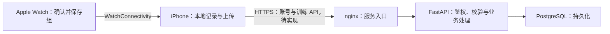
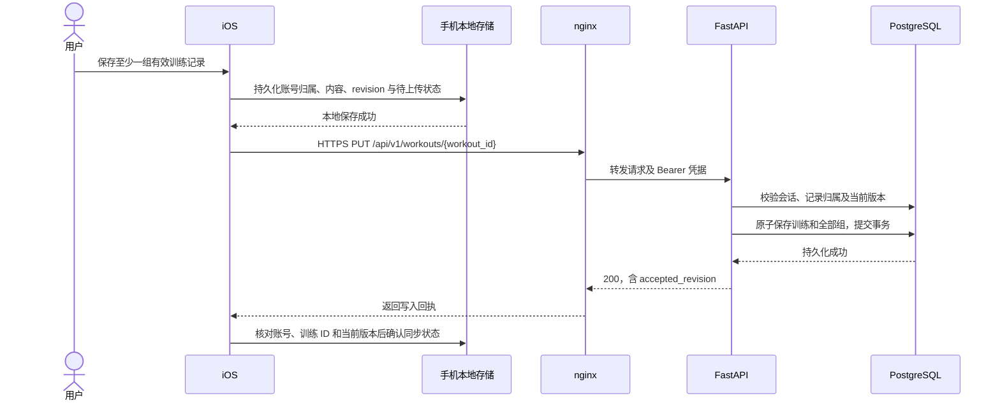
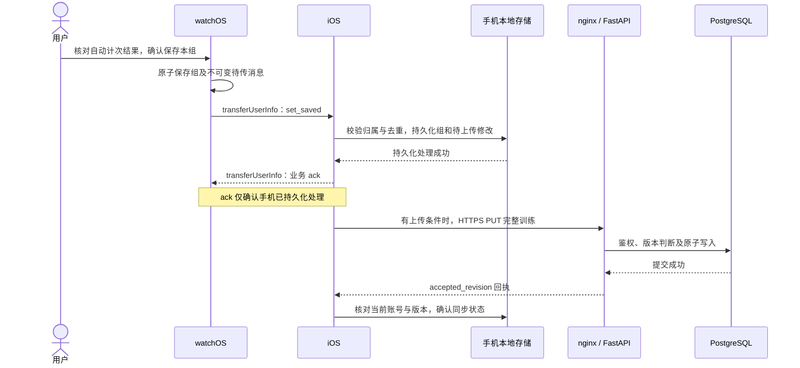
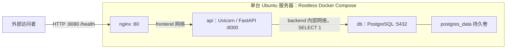

# RepFlow 概要设计：后端章节（评审草稿）

版本：v0.1；日期：2026-10-29；章节负责人：hulaoya。

本稿供 A2 团队汇总，描述后端职责、数据流和部署。客户端遵循已有契约，实现细节待负责人确认；评审后再与其他章节合并。

## 1. 依据与当前状态

| 依据 | 本章引用的内容 |
| --- | --- |
| [ADR 0001](../adr/0001-backend-stack.md) | 技术栈、异步访问、会话与版本维护 |
| [ADR 0002](../adr/0002-backend-deployment.md) | Rootless Docker、构建发布与镜像来源 |
| [OpenAPI 1.0.0](../api/openapi.yaml) | 已冻结的 HTTP 字段与行为 |
| [手表与手机消息格式 v1](../data/02-watch-phone-messages.md) | 保存、确认、去重、归属及结束顺序 |
| [后端部署与验收](../deployment.md) | 三服务部署、健康检查及更新恢复记录 |
| [后端需求](../requirements/03-backend.md)、[iOS 需求](../requirements/01-ios.md) | 账号隔离、本地优先与记录同步 |

当前状态：

- **已交付**：后端工程、双架构 CI、私有镜像发布、三服务部署及健康检查。既有验收见部署文档，本次未重测。
- **已冻结、待实现**：账号、训练上传、删除与查询接口；下文业务数据流为目标流程。
- **待确认**：iOS 本地模型及交互映射；A3 待客户端输入确认后设计表、索引与迁移。

技术决策引用 ADR；交付进度以工程和验收记录为准。版本及镜像摘要统一见 ADR、锁文件和部署配置。

## 2. 系统边界与模块职责

业务链路为「手表 → iPhone → 后端」；iPhone 可独立手动记录，手表不直连后端。

上图为目标架构；当前仅开放 HTTP `/health`，业务接入前须完成 HTTPS 和路由配置。

| 模块 | 职责与边界 | 状态 |
| --- | --- | --- |
| watchOS | 保存组与待传记录，收到手机业务确认后完成交接；不管理后端 token | 契约已冻结；保存、发送与恢复实现待手表负责人确认 |
| iOS | 管理凭据、按账号存储及上传；将手表消息映射为训练，展示历史和统计 | 原型已合入；模型、队列及页面实现待 iOS 负责人确认 |
| 后端 | 鉴权、校验、账号隔离、原子版本写入、删除及只读查询 | 健康检查已交付；业务按契约实现 |
| 算法 | 提供自动计次；采集、标注及回放数据不上传为真实训练 | 接入及支持动作待算法、手表负责人确认 |
| 部署与 CI | 检查及发布镜像，维护入口、进程、持久卷和部署恢复记录 | 骨架已验收；业务发布变更另行确认 |

本期为手机单向上传，不提供换机恢复或多设备合并；Web 看板留待后续，本章不新增接口。

## 3. 后端内部职责

以下仅划分逻辑职责，不预设目录或额外服务。

| 职责 | 处理内容 | 设计约束 |
| --- | --- | --- |
| HTTP 接口 | 校验请求，返回约定结果与错误码 | Pydantic 与 OpenAPI 一致，不回显敏感输入 |
| 账号与鉴权 | 注册、登录、当前会话退出及请求鉴权 | 账号归属取自已验证会话，不信任上传参数 |
| 训练写入 | 按 ID 比较版本、完整保存或删除 | 训练及全部组原子生效，失败不留部分更新 |
| 训练查询 | 当前账号有效记录的时间筛选与游标分页 | 账号隔离；排序与筛选遵循契约 |
| 数据访问 | 连接、Session、事务及迁移 | SQLAlchemy AsyncSession、psycopg、Alembic；表结构等 A3 |
| 健康检查 | 执行 `SELECT 1` 检查数据库链路 | 正常 200，失败或超时 503；不代表业务验收通过 |

随机 token 固定有效 365 天，不续期。数据库存 token 摘要、会话状态及 Argon2id 密码哈希；手机将 token 存 Keychain。在线退出只撤销当前会话。详见 ADR 0001 和 OpenAPI。

## 4. 关键数据流

以下目标流程遵循冻结契约，尚未端到端验收；客户端存储与调度实现待负责人确认。

### 4.1 手机手动记录上传

- 已登录账号断网仍可本地记录，恢复后上传；模型和任务组织方式待 iOS 确认。
- 手机维护 `revision`，重试保持 ID、版本、内容不变。后端接受更大版本完整覆盖；同版本同内容幂等成功，其余版本冲突返回 409，不按到达顺序覆盖。
- 数据库提交后才返回成功；旧回执不能把新修改标为已同步。
- 训练至少一组；删除最后一组改发整次训练 DELETE。后端保留删除标记，阻止同一 ID 恢复；细节见 OpenAPI。

### 4.2 手表一组同步到后端

- 手机 ack 不等待后端，后端失败也不撤销接收；“已传到手机”不等于“已同步”。
- 新训练绑定接收时的登录账号，已有训练沿用原账号；未登录不保存、不 ack，记录留在手表。实现待双端确认。
- 沿用手表训练和组 ID；重复消息不覆盖编辑或恢复删除。删除、去重与结束交接状态须保留，存储在 A3 对齐。
- 手表收齐所有已确认组的 ack 后才发 `workout_ended`；手机保存结束信息、推进版本后再上传。结束清单不覆盖手机编辑或手动组。
- 组时间仅存手机，HTTP 用 `sets` 数组表达顺序；原估计与最终次数分别保留，历史与统计使用最终值。

### 4.3 失败与恢复

| 情况 | 契约规定的行为 |
| --- | --- |
| 网络错误、超时、500、503 | 保留任务和内容，有限次数退避重试；超时不代表未写入 |
| 401 登录失效 | 停用旧凭据、保留记录，同账号重登后续传 |
| 409 版本或组 ID 冲突 | 处理冲突，不盲目重试或抬高版本覆盖 |
| 410 训练已删除 | 不恢复同一训练 ID；重新记录使用新 ID |
| 422 输入不合法 | 纠正输入；训练内容改变时推进 revision |
| 主动离线退出 | 清 token、停止上传、保留记录；服务端未确认撤销，旧 token 可能有效至到期 |

重试、前后台调度和提示待 iOS 确认；同步时延留到配对真机联调实测。

## 5. 部署与发布

### 5.1 当前健康检查部署

- 仅 nginx 映射宿主 8080。nginx/API 共用 frontend 网络，API/数据库共用 backend 内部网络；nginx 不直连数据库。
- 初始为 1 个 Uvicorn worker、连接池大小 2、无额外溢出；健康检查预算 3 秒，仅作骨架参数，不承诺业务容量或时延。
- PostgreSQL 18 数据卷挂载 `/var/lib/postgresql`，重建、更新及退出 SSH 后保留；持久卷不替代备份，业务接入前确认备份恢复。
- Docker 由用户级 systemd 和 linger 管理；nginx 持续解析 API 服务名以适应换址。配置检查与重建步骤见部署文档。

### 5.2 构建、发布与更新

1. 相关后端、部署改动触发双架构原生 CI：格式、测试、覆盖率及临时 Compose 恢复检查；PR 不发布镜像。
2. 合入 dev/main、检查通过后发布私有 GHCR API 多架构镜像；PostgreSQL/nginx 备用同步独立运行，失败仍标红。
3. 负责人核对提交、配置及镜像摘要，检查配置后人工更新、验收；当前未自动部署到服务器。
4. 回退恢复已验证镜像和配置，保留卷与密码。实际验收范围见部署文档；生产版本回退尚未实测。

CI 仅发布任务可写镜像，服务器凭据只读；版本维护沿用 ADR。

### 5.3 业务接入前的条件

- 开放业务路由前完成 HTTPS；当前仅 `/health` 可用，其余路径 404。域名、证书及入口方案待后端确认，不新增工具选型。
- A3 模型对齐后设计业务表、权限及迁移，并补账号、训练接口测试。
- B1 要求“自动部署”，与现状不同；范围和方案待后端、组长确认后实施。

## 6. 安全与验证边界

账号归属取自会话；先验权限，再披露版本或删除状态，跨账号统一响应。token 通过 HTTPS Authorization 头发送；密码、token、请求原文不写日志，真实部署地址、凭据和 `.env` 不入库。

健康检查仅证明连接与查询可用。已有故障、超时及重建恢复测试不替代账号隔离、并发版本、删除重放和端到端测试；方案在 A4 对齐，性能与同步时延按实测评审。

## 7. 待确认与评审清单

以下待确认实现方案，不重新讨论已冻结的字段与语义。

| 编号 | 待确认内容 | 相关负责人 | 对后续的影响 |
| --- | --- | --- | --- |
| A2-BE-01 | iOS 页面与本地模型；账号、revision、上传及删除任务的持久化 | iOS、后端 | A3 确认后再定业务表与迁移 |
| A2-BE-02 | 手表保存、发件箱、恢复与手机持久化 ack 的衔接 | watchOS、iOS | 确认交接实现与真机验证，不改消息语义 |
| A2-BE-03 | A1 动作清单、自动计次范围及重量含义 | iOS、watchOS、算法；后端对齐字段 | 确认动作校验与展示，不照搬旧原型 ID 或名单 |
| A2-BE-04 | HTTPS 域名、证书、入口及 B1 自动部署方案 | 后端、组长 | 登录联调与业务发布的前置工作 |
| A2-BE-05 | 数据库权限、备份恢复、密码校验并发及连接池参数 | 后端 | 业务接入时实测确认容量 |
| A2-BE-06 | 客户端章节、模块图与两条数据流的联合审查 | 各相关模块负责人 | 审查后汇总，整份概要设计尚未批准 |

本轮重点 review：职责与数据流是否准确、现状与目标是否分清、待确认项是否完整。客户端细节确认后补充，业务表留给 A3。

由 Codex 协助起草，后端负责人已 review；其他模块实现与联合审查仍见第 7 节。
