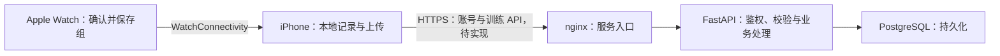
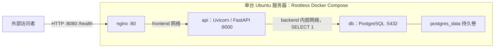
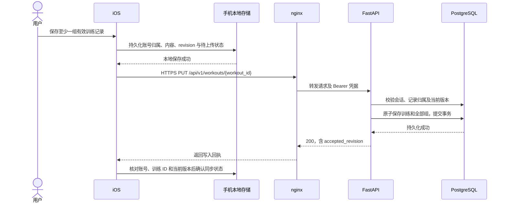
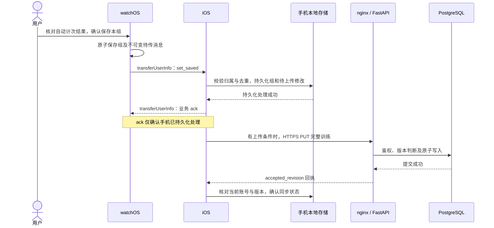

# RepFlow 概要设计

版本：v0.2 联合评审稿；汇总日期：2026-10-31；更新日期：2026-11-01；文档负责人：@whj-thu。关联 [#68](https://github.com/Team-Party-A/repflow/issues/68)。

本文与下列模块章节共同组成 A2 概要设计，以本页为统一入口。系统架构、部署图和两条跨端业务数据流只在本页维护；模块内部设计留在对应章节，避免重复维护。章节内容已交付不等于整个系统已实现或通过联合评审。

## 1. 文档组成与依据

| 章节 | 内容 | 章节来源与负责人 |
| --- | --- | --- |
| 本总览 | 跨模块边界、公共图、数据流、联合评审问题 | #68；watchOS / 文档负责人 @whj-thu |
| [watchOS](概要设计-watchOS.md) | 训练页、计次、研究录制、本地保存与发件箱；回应 A2-BE-02/03 | #68；@whj-thu |
| [iOS](概要设计-iOS.md) | 页面、账号、本地模型、接收事务与上传队列 | #64 / #77；@wenshare71 |
| [后端](概要设计-后端.md) | 鉴权、写入/查询、事务、部署发布及原待确认项 | #58 / #59；hulaoya |
| [算法](概要设计-算法.md) | 录制、标注、离线评估和 Swift 增量计次的输入输出 | #72 / #79；@shooterli |

字段与行为以已冻结的 [OpenAPI](../api/openapi.yaml)、[手表消息契约](../data/02-watch-phone-messages.md)、[录制格式](../data/01-sensor-recording-format.md)为准。技术栈、运行维护引用 [ADR 0001](../adr/0001-backend-stack.md)、[ADR 0002](../adr/0002-backend-deployment.md)；需求与验证分别见[需求规格说明书](../requirements/需求规格说明书.md)、[测试计划](../testing/测试计划.md)。本次汇总不改契约、模块选型或其他负责人已确认的技术结论。

实现与设计的区别：#63 已交付共享动作清单；#67 / #78 已交付研究录制与文件导出，且有落腕真机录制记录；#70 只做训练页面骨架。研究 JSON 导出、页面手动调整次数，都不能作为自动计次准确性或训练业务同步已完成的证据。各模块原稿的状态描述保留其交付时点，当前实现进度以对应 Issue、PR 与验收记录为准。

## 2. 系统架构与模块边界

业务主链路为“手表 → iPhone → 后端”；iPhone 也可独立手动记录，手表不直连后端。下图沿用后端原稿的目标架构；图中待实现标注不替代当前工程进度。

| 模块 | 负责 | 交接边界 |
| --- | --- | --- |
| watchOS | 选动作、明确组边界、展示估计和核对结果、本地确认保存、发件箱补发 | 收到手机持久化业务 ack 才完成相应任务；不管理账号/token，不显示后端“已同步” |
| iOS | 账号与凭据、按账号的本地记录、手表接收、编辑/删除、历史统计、上传调度 | 接收事务提交后 ack；上传通过后端版本回执确认，两种确认不互相替代 |
| 后端 | 鉴权、账号隔离、训练完整写入、版本比较、删除与只读查询 | 持久化事务成功后返回；不接收传感器原始文件、不负责手表在线计次 |
| 算法 | 数据质检、独立标注与评估、逐样本计次规则、回放对齐 | 向手表提供估计与采样异常信息；不保存业务记录、不决定账号归属 |
| 部署与 CI | 格式/构建/测试、镜像发布、入口与持久卷、验收与恢复记录 | 目标业务接入前满足后端章节列出的条件；不将健康检查当业务验收 |

研究数据另走“Watch 录制 JSON → WatchConnectivity 文件传输 → iPhone 分享 → 电脑质检/标注”链路，详见[录制导出说明](../../apps/apple/README.md)。它与训练消息 `set_saved` / `workout_ended` 分开，研究文件不进入训练库或后端上传队列。

## 3. 部署图与运行边界

以下为后端章节已验收的健康检查部署快照；业务接入的 HTTPS、路由、迁移、备份及发布条件见[后端章节第 5 节](概要设计-后端.md#5-部署与发布)。不把该图解释为所有业务路由已上线。

Watch 与 iOS App 分别运行在配对设备上，共用 `apps/apple/Shared/` 的动作定义；服务端运行在单台 Ubuntu 主机的 Rootless Docker Compose 中。数据库持久卷不替代备份。CI 构建发布与服务器实际更新是不同步骤，已确认部署方案仍以后端章节和[部署说明](../deployment.md)为准。

## 4. 关键数据流

以下两条目标业务数据流从后端章节集中到本总览，遵循冻结契约。手机和手表的实现分工分别见对应章节；业务链路尚未端到端验收。研究录制文件的导出已完成单独验证，不等于这两条训练业务链路已完成。

### 4.1 手机手动记录上传

- 已登录账号断网仍可本地记录，恢复后上传；模型和任务组织方式待 iOS 确认。
- 手机维护 `revision`，重试保持 ID、版本、内容不变。后端接受更大版本完整覆盖；同版本同内容幂等成功，其余版本冲突返回 409，不按到达顺序覆盖。
- 数据库提交后才返回成功；旧回执不能把新修改标为已同步。
- 训练至少一组；删除最后一组改发整次训练 DELETE。后端保留删除标记，阻止同一 ID 恢复；细节见 OpenAPI。

### 4.2 手表一组同步到后端

- 手机 ack 不等待后端，后端失败也不撤销接收；“已传到手机”不等于“已同步”。
- 新训练绑定接收时的登录账号，已有训练沿用原账号；未登录不保存、不 ack，记录留在手表。实现待双端确认。
- 沿用手表训练和组 ID；重复消息不覆盖编辑或恢复删除。删除、去重与结束交接状态须保留，存储在 A3 对齐。
- 手表收齐所有已确认组的 ack 后才发 `workout_ended`；手机保存结束信息、推进版本后再上传。结束清单不覆盖手机编辑或手动组。
- 组时间仅存手机，HTTP 用 `sets` 数组表达顺序；原估计与最终次数分别保留，历史与统计使用最终值。

### 4.3 失败与恢复

| 情况 | 契约规定的行为 |
| --- | --- |
| 网络错误、超时、500、503 | 保留任务和内容，有限次数退避重试；超时不代表未写入 |
| 401 登录失效 | 停用旧凭据、保留记录，同账号重登后续传 |
| 409 版本或组 ID 冲突 | 处理冲突，不盲目重试或抬高版本覆盖 |
| 410 训练已删除 | 不恢复同一训练 ID；重新记录使用新 ID |
| 422 输入不合法 | 纠正输入；训练内容改变时推进 revision |
| 主动离线退出 | 清 token、停止上传、保留记录；服务端未确认撤销，旧 token 可能有效至到期 |

重试、前后台调度和提示待 iOS 确认；同步时延留到配对真机联调实测。

## 5. 章节对齐与联合评审

| 编号 | 汇总结果 / 待确认点 | 由谁确认 |
| --- | --- | --- |
| A2-BE-01 | iOS 章节第 3、6 节提供本地实体、账号隔离、revision 与任务同事务方案；不在 A2 设计业务表 | iOS、后端 |
| A2-BE-02 | watchOS 章节第 4、6 节给出保存、发件箱、恢复及业务 ack 的实现安排；与 iOS 第 5 节对齐 | watchOS、iOS |
| A2-BE-03 | 动作与重量以 `Shared/Exercise.swift` 为唯一来源；首批自动计次为弯举、肩推，深蹲先采集；Watch v1 重量固定 null | watchOS、iOS、算法；后端对齐字段 |
| A2-BE-04/05 | HTTPS、发布与数据库运行条件保留后端原稿结论，不由汇总者新增选型或性能门槛 | 后端、组长 |
| A2-BE-06 | 所有模块负责人在本次 PR 中确认自己部分后，才可称联合审查完成 | 各模块负责人 |
| A2-SUM-01 | iOS 第 2 节“账号与凭据负责注册登录”与第 4 节“上传队列是唯一访问后端的模块”表述待统一；负责人确认暂列待确认，不阻塞其他内容；本次保留原文 | iOS 负责人，文档负责人转达 |
| A2-SUM-02 | 共享清单说明非自动动作可在手表手动操作，但冻结消息 v1 不提供手表手动录组消息；#70 经负责人确认全部 7 个动作均可手动完成一组，仅保存在手表，不发送业务消息；后续同步接入前另行确认兼容路径 | watchOS、iOS |

本稿不代替各模块批准。章节结论存在冲突时，由文档负责人联系相应负责人确认，再按确认结果修改；契约改动另走契约评审。请负责人在 PR 中分别确认 watchOS、iOS、后端、算法部分及公共图，不由 agent 代为确认或代发邀请。

## 6. 验证与后续交付

本次文档检查覆盖相对链接、Markdown 代码围栏、四张公共 Mermaid 图及原技术结论的保留情况。具体功能验证沿用[测试计划](../testing/测试计划.md)，不新增误差、重试频率或覆盖率目标。

- #70：按确认后的原型范围完成页面骨架，负责人真机走一组并录屏，Apple CI 通过。
- 业务交接：验证本地写失败、进程重启、无 ack、重复消息、换账号、删除后重放与结束顺序；不能以录制文件传输代替。
- 计次接入：先固定开发集规则，Python/Swift 回放对齐，再做实际动作、落腕和最低系统验证；用户修正不覆盖原估计。

由 Codex 协助汇总；各模块原稿来源保留在本页目录中。本文为联合评审稿，未将尚未执行的验证或尚未收到的负责人确认标为完成。
