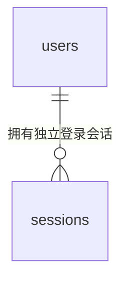

# 账号与会话设计（#60）

2026-10-29，后端负责人在会话中逐项确认。仅覆盖 A3 的账号部分；训练、组模型仍在 #57 等待客户端对齐。

## 字段与约束

| 表 | 字段 | 类型与约束 |
| --- | --- | --- |
| users | user_id | 后端生成 UUIDv4，原生 UUID 主键 |
| users | username | VARCHAR(32)，非空、唯一；应用校验后转小写，数据库检查 `[a-z0-9_]{3,32}` |
| users | password_hash | 非空 TEXT，保存完整 Argon2id 字符串，不拆盐 |
| users | created_at | 非空带时区时间，由后端生成 |
| sessions | token_hash | SHA-256 的 32 字节摘要，主键；长度检查，不另建 session_id |
| sessions | user_id | 非空 UUID 外键，引用 users.user_id |
| sessions | issued_at / expires_at | 非空带时区时间；有效期固定 365×24 小时 |
| sessions | revoked_at | 可空带时区时间；空表示未撤销 |

时间由后端按 UTC 生成，API 不接收客户端时间。接口保持 [OpenAPI 1.0.0](../api/openapi.yaml) 的字段和语义；不增加返回字段。

## 事务与安全

- 注册：用户和首次会话同一事务提交；数据库唯一约束处理并发重名，失败全部回滚。
- 登录：账号标识不变，每次生成独立 token；未知账号和错误密码均执行密码校验并返回相同 401。
- 退出：事务内仅撤销当前未过期会话；提交后返回 204，重复退出为 401，其他会话有效。
- token 仅响应交付；数据库不存原 token，密码不存明文。失败响应与日志不输出请求值、连接串或驱动错误详情。
- 密码计算在线程池执行，并发先限制为 1；使用已固定 pwdlib 的推荐默认 Argon2id 参数。目标服务器的时间、内存与并发验收仍在上线前完成，不将开发机结果当作生产定参。

## 迁移与实施步骤

1. Alembic `0001_accounts` 创建两表；回退先删除会话、再删除用户。应用启动不自动建表或执行迁移。
2. 实现 `/api/v1/auth/register`、`login`、`logout`，错误与缓存头遵循契约。
3. 临时 schema 内执行真实迁移、数据库约束和 HTTP 测试，保留原有健康检查测试；不写测试库 public schema。
4. 验收后交给负责人逐段 review；服务器迁移、HTTPS 和线上注册／登录／退出由后续授权操作验收。

本地在 `backend/` 使用 `uv run --locked alembic upgrade head`。运行时镜像带迁移文件，可由负责人在相配环境执行 `python -m alembic upgrade head`；不在启动命令中自动迁移。

## 测试范围

注册及大小写／并发重名；输入边界及 Unicode 密码；独立会话与稳定 user_id；365 天到期边界；当前会话撤销；注册事务回滚；数据库约束和模型／迁移一致性；错误、日志和数据库无明文凭据；迁移升级／回退／重建。CI 沿用现有后端工作流，无新增依赖。

本地验收：临时 PostgreSQL 18.6 上 56 项测试通过，整体覆盖率 99%；ruff、密钥扫描及运行镜像构建通过。Docker Desktop 重启后新容器仍无法启动，因此数据库测试使用本机临时实例；容器联通、CI 与服务器验收尚未完成。
