# 可交互原型

第 6 周交付物。原型以[需求规格说明书](../requirements/需求规格说明书.md)为输入，视觉按 [UI 规范](../design/UI规范.md) v0.2（Chalk & Volt），文字以[术语表](../design/术语表.md)为准。

原型工具：单文件 HTML，用浏览器直接打开，不需要安装任何东西。和 UI 规范附带的静态稿（`docs/assets/ui-*.html`）是同一种做法，两端原型都用它。

## iOS 端

- 原型：[ios.html](ios.html)
- 在线打开（合入 `dev` 后可用）：<https://htmlpreview.github.io/?https://github.com/Team-Party-A/repflow/blob/dev/docs/prototype/ios.html>
- 本地打开：克隆仓库后双击 `docs/prototype/ios.html`。

页面左边是手机，右边是演示控制面板。面板上的按钮模拟手表发消息、断网、上传失败、登录过期、杀掉 App，**不属于 App 界面**。演示账号 `demo` / `123456`，数据只在页面内存里，刷新即重置。

深链接（评审时可以直接跳到某一屏）：`ios.html#/today`、`#/history`、`#/settings`、`#/register`、`#/detail/w1`；加 `?theme=dark` 看深色。

### 覆盖的 Must 用户故事

| 需求 | 界面 | 怎么演示 |
| --- | --- | --- |
| REQ-IOS-001 注册与登录 | 登录、注册 | 输错密码 → 「用户名或密码错误」；用 `demo` 注册 → 「用户名已被使用」；新用户名注册后直接进入；点「杀掉并重新打开」不需要再登录。 |
| REQ-IOS-002 退出与登录失效 | 设置 | 有待上传记录时退出，提示条数；重新登录 `demo` 后记录都在、继续上传；新账号只看到自己的记录（空状态）。点「让登录失效」后改一条记录 → 横幅「重新登录」。 |
| REQ-IOS-003 接收手表的训练 | 今天、详情 | 「手表发来一组」→ 出现新训练，来源「自动计次」；「重复发送上一组」不新增；断网照常保存为待同步；未登录时不保存，组留在手表上，登录后补发。 |
| REQ-IOS-004 手动添加 | 手动记录训练 | 次数填 `0`、`-1`、`2.5` → 「请输入有效的整数次数」；重量可不填，填负数 → 「重量不能小于 0」。 |
| REQ-IOS-005 训练详情 | 详情 | 时间段、动作数、组数、动作总次数、同步状态；组按动作分开列，每组显示最终次数、重量和来源。 |
| REQ-IOS-006 修改 | 修正第 N 组、添加一组 | 改次数、重量或动作；添加或删除一组后摘要和统计随之变化；已同步的训练改完回到「待同步」。 |
| REQ-IOS-007 删除 | 详情 | 「删除训练」先弹确认；确认后从历史和统计中移除。 |
| REQ-IOS-008 历史列表 | 历史 | 按开始时间倒序、按天分组；没有记录时显示「还没有训练记录」；断网照常显示。 |
| REQ-IOS-009 基础统计 | 今天、历史 | 训练次数、组、动作总次数；今天页近 7 天，历史页近 7 天 / 近 30 天 / 全部。 |
| REQ-IOS-011 同步状态 | 全部列表与详情 | 待同步 / 已同步 / 同步失败三态，上传中临时显示「正在上传」；点「下一次上传失败」再改一条 → 同步失败 → 「重试」或恢复网络后重传。 |

REQ-NFR-101（本地持久化）、REQ-NFR-102（凭据安全）没有界面，原型里只用「杀掉并重新打开」示意记录还在。Should 项（REQ-IOS-010 按动作看趋势、REQ-IOS-012 训练模板）不在本原型范围内。

### 截图

| 登录 | 今天 | 历史（深色） |
| --- | --- | --- |
| 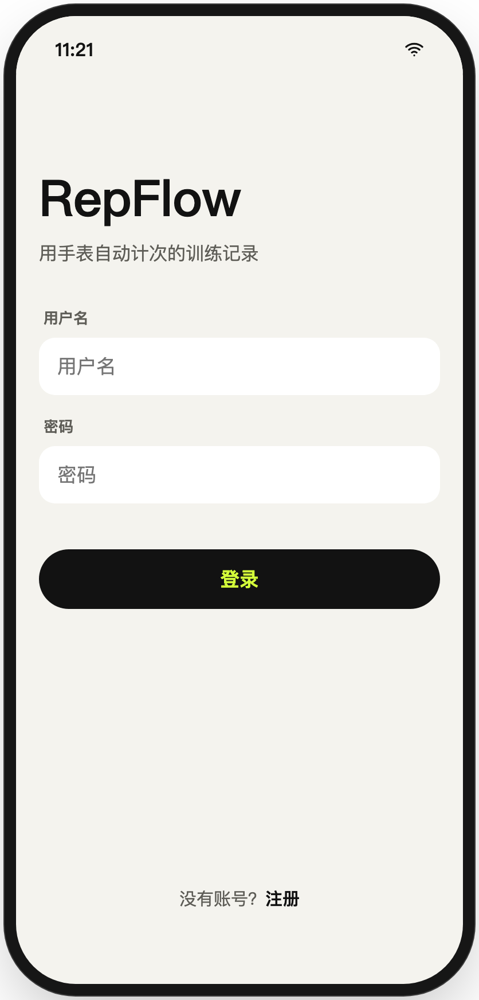 | 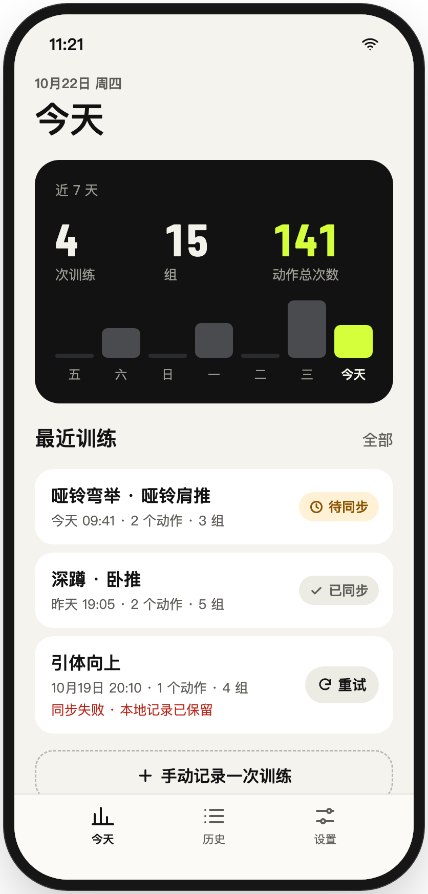 | 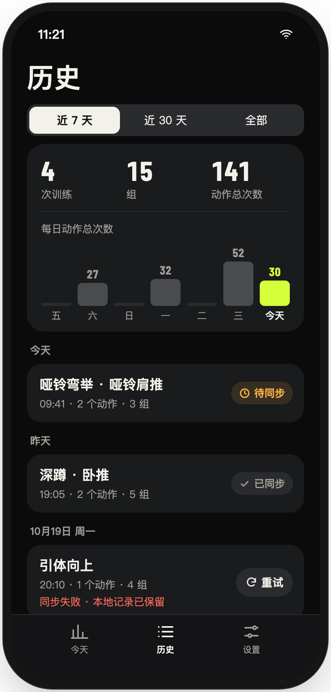 |

| 训练详情 | 同步失败（深色） | 设置 |
| --- | --- | --- |
| 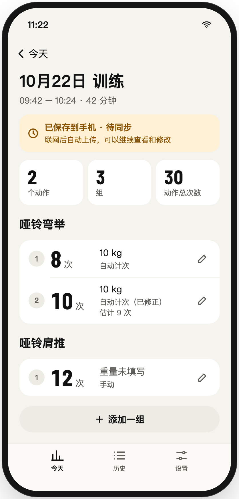 | 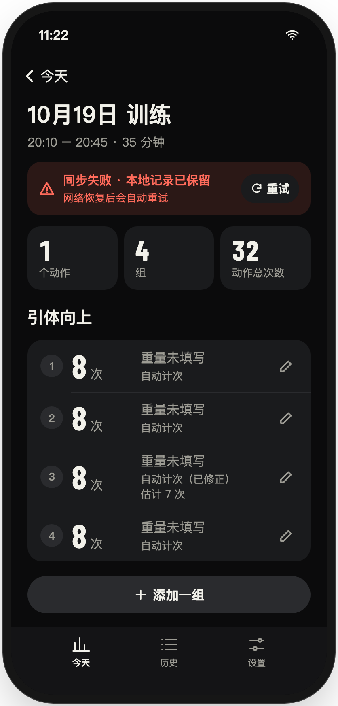 | 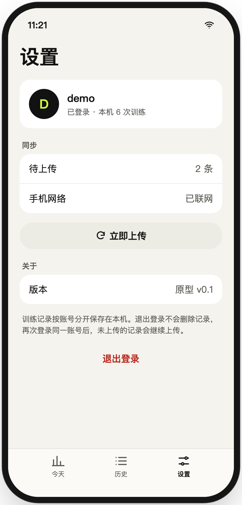 |

### 原型里做的取舍

- 删除训练里的最后一组 = 删除整次训练，并单独提示（D-30：一组都没确认的训练不生成记录）。
- 统计范围写「近 7 天」「近 30 天」，避开周起点未定的问题（UI 规范 3.3）。
- 用户名、密码规则未定（REQ-IOS-001 待决），原型只检查非空。
- 训练详情是导航栈里的一层，和 iOS 原生一样保留底部 Tab。

## watchOS 端

- 原型：[watch.html](watch.html)，关联 [#10](https://github.com/Team-Party-A/repflow/issues/10)。
- 在线打开（合入 `dev` 后可用）：<https://htmlpreview.github.io/?https://github.com/Team-Party-A/repflow/blob/dev/docs/prototype/watch.html>
- 评审分支预览：<https://htmlpreview.github.io/?https://github.com/Team-Party-A/repflow/blob/feature/watch-interactive-prototype/docs/prototype/watch.html>
- 本地双击 HTML；或在仓库根目录运行 `python3 -m http.server 8765 --bind 127.0.0.1`，打开 <http://localhost:8765/docs/prototype/watch.html>。

与 iOS 原型相同，使用单文件 HTML + 演示控制台。Watch 固定深色，支持 41 mm / 45 mm、默认 / 放大文字；按 1.5 倍显示，表盘内部可滚动。无外部字体、脚本或运行依赖。

计次由面板「模拟 +1／+8／+9 次」注入，**没有调用传感器或计次算法**。演示数据只写当前浏览器的 localStorage（键 `repflow-watch-prototype-v1`），刷新保留；「重置演示数据」经确认后清空本原型数据，不操作手机、手表或后端。浏览器禁用存储时显示失败提示，不报告组保存成功。

### 覆盖的 Must 用户故事

| 需求 | 界面与走查 |
| --- | --- |
| REQ-WATCH-001 选择动作 | 初始未选择不能开组；选哑铃弯举／肩推后可开组；深蹲写「仅手动 · 请在手机记录」，不能自动开组。动作仅是交互示例，不冻结支持名单。 |
| REQ-WATCH-002 开组与计次 | 每组从 0 起计、显示估计次数与结束入口；面板可模拟组内停顿、权限不可用和采样中断；中断保留估计、停止注入并提示核对。 |
| REQ-WATCH-003 核对与放弃 | 结束本组进入待核对，± 或数值框修正；0、负数、小数不可保存，1／2 次短组可保存。放弃先确认，取消保留候选。 |
| REQ-WATCH-004 本地保存 | 保存 8 次，下一组估计 9 改 10，总共 2 组 18 次；修正仍显示自动计次和原估计。模拟写入失败保留候选，重试／重复确认不新增一组。 |
| REQ-WATCH-005 下一组与结束 | 下一组可换动作；计次中结束训练先要求结束本组，待核对时可返回或确认放弃后结束。已保存组保留；空训练不生成记录；开始新训练使用新身份。 |
| REQ-WATCH-006 交接 | 断连保存两组→刷新／模拟重开→恢复补发；手机写库失败不确认，确认丢失后重发不重复。未登录不接收；首次接收归当前账号，已有训练后续组归原账号，切账号隔离显示。 |
| REQ-NFR-201 已保存组与待传保留 | localStorage 示意已保存结果及待传队列；刷新不丢，结束／放弃别的组不清空。它不是原生持久化或硬件重启测试。 |
| REQ-NFR-202 小屏与可访问性 | 面板切换尺寸与文字大小；核心操作有文字、图标与颜色，± 有可访问名称，数字不逐次触发 live region。Tab 可访问操作，视口内内容可滚动。 |

REQ-WATCH-007 是 Should：保留组间休息页，演示「从手动结束本组起正计时」，核对／修正不重置；可关闭休息计时，Must 流程照常完成。不模拟休息自动识别，不增加自动保存或自动开组。

### 截图

以下为浏览器实际截图，非真机运行证明。

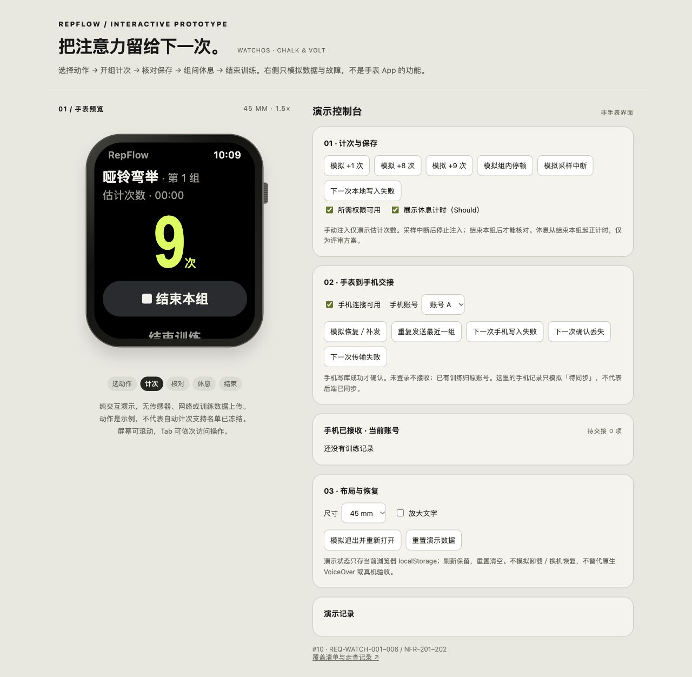

| 选择动作 | 计次中 | 核对修正 |
| --- | --- | --- |
| 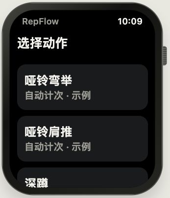 | 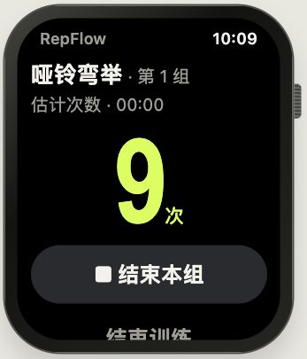 | 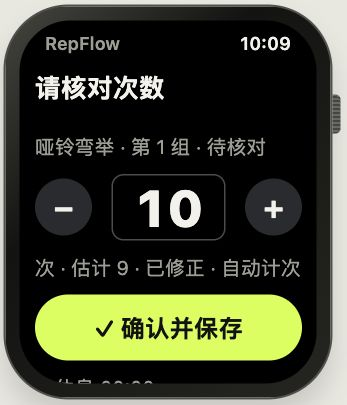 |

| 组间休息／交接状态 | 保存失败 | 结束训练 |
| --- | --- | --- |
| 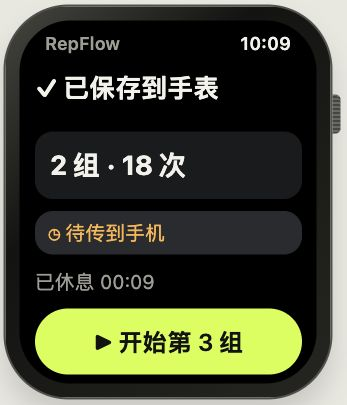 | 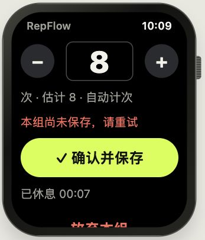 | 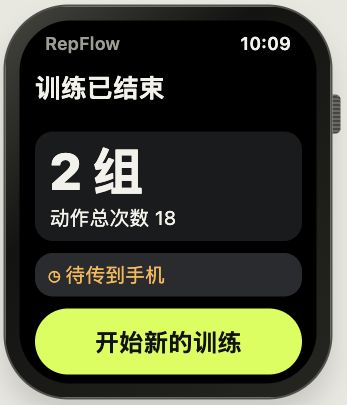 |

| 采样中断 | 41 mm 放大文字 |
| --- | --- |
| 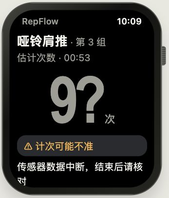 | 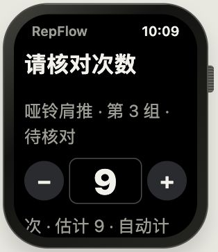 |

### 验证与边界

- `node --test docs/prototype/watch.test.cjs`：17 项无依赖状态回归，覆盖短组、非法次数、8+10、重复确认、真实浏览器存储接口抛错、断连恢复、账号归属、确认丢失、采样故障、放弃与空训练等。
- 浏览器走查主流程、离线两组 18 次、刷新恢复、未登录／重新登录、重复发送、保存失败重试及小屏放大文字。JavaScript 语法检查通过。
- 浏览器演示不用原生框架；不将它视为 Apple 构建、Swift 单测、VoiceOver 实测、watchOS 10 真机、采样准确率或 WatchConnectivity 可靠性交付。这里的账号为固定模拟 A/B，不接真实凭据。
- 状态遵循已合入需求，具体消息封装、结束乱序、删除标记及上传 revision 由 [#34 契约 PR](https://github.com/Team-Party-A/repflow/pull/51) 与 #32 接收方共同评审；本原型不代替协议实现。
- 未冻结的动作范围、次数上限、休息策略和真实同步时延不通过本原型决定。原型不增加手表重量录入、训练模板、心率或热量。

由 Codex 协助实现；人工视觉与交互评审随本 PR 进行。
