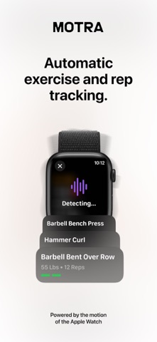
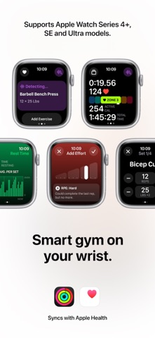
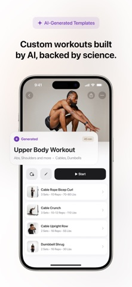

# 竞品分析

调研日期：2026-10-15；版本：v2。用途：为第 6 周需求规格说明书及中期答辩提供依据。

## 本阶段交付

本阶段交付为基于官方公开资料的竞品报告，评审重点是来源可靠、流程分析清楚、结论与项目范围一致。未进行实际使用测试；后文实测清单供后续体验验证使用，不作为本次文档交付的前置条件。

## 对比口径

每款产品按以下维度填写，便于合并：产品与证据、记录方式、计次方式、手表端、历史与统计、同步与异常恢复、收费、广告、可借鉴设计、RepFlow 不做的功能。

本次为公开资料调研：阅读官方帮助中心，并核对美国区 App Store 的产品信息与开发者提供的截图；未进行真机训练测试。下文的体验判断是根据公开交互流程作出的分析，不代表实测准确率、耗时或稳定性。未核实的项目明确记为“待实测”，不以没有找到资料推断产品没有该功能。

## Motra

### 产品与证据

调研对象为 Train Fitness Inc. 的 **Motra AI Workout Fitness Coach**，Apple App ID 为 `1548577496`，原名 Train Fitness；不与其他同名 MOTRA 产品混淆。查阅当日 Apple 查询接口返回版本为 6.4.4，最低 iOS 版本为 17.0；这些是商店元数据，非已安装设备的版本记录。[M1]

核心定位是利用 Apple Watch 的腕部运动数据自动记录力量训练。自动识别动作与自动计次是两个能力：RepFlow 当前 Must 只做“先手动选动作，再组内计次”，不能直接照搬 Motra 的完整自动识别范围。[M2][D-02]

### 功能与体验对比

| 维度 | Motra 官方资料可核实的行为 | 对 RepFlow 的启示与边界 |
| --- | --- | --- |
| 记录方式 | 可在 iPhone 或 Watch 开始训练；自动检测后确认组并调整重量；不支持自动检测的动作可手动加入。[M2] | 保留开始、结束、确认和修正；MVP 先手动选动作，降低动作识别成本。 |
| 计次方式 | 官方宣称以腕部运动自动计次；默认至少完成 3 次才触发自动检测，可调低以记录 1–2 次短组，但官方提示会增加误检测。单侧动作有专门的计次数口径。[M3][M10] | 必须定义“一次”的含义，同时检查短组漏计与喝水等误触发；不把“三次触发”直接作为我方规则。 |
| 手表端 | 支持手表训练、组记录和次数/重量调整；自动检测可暂停，暂停时仍可记录时长等训练信息。[M2][M4] | 主要交互放在腕上；自动计次失败时保留手动修正，不让整个训练无法保存。 |
| 历史与统计 | PR Breakdown 展示动作在不同次数下的最大重量，并区分真实个人纪录与预测重量。[M5] | 首版历史和统计使用实际记录；预测值与事实必须区分，不在 Must 中引入 1RM 或恢复模型。 |
| 同步 | 训练完成后 Watch 自动同步到已连接的 iPhone；未连接时先存在 Watch，后续同步；可重新保存以补发。[M6] | 本地保存优先，明确待同步、失败、成功；我方手机到后端按 D-03 单向上传，不引入双向冲突合并。 |
| 异常恢复 | 官方说明 Watch 保存后交给 iPhone 上传服务器；说明了待上传数据及本地数据存在保留期限。[M7] | 用户要能看见同步失败及重试入口；“失败不丢记录”需要验收测试，不照抄竞品的保留天数。 |
| 收费 | Free 与 Pro 分层；Pro 包括更多自动检测动作、进阶统计和训练生成等，月付/年付且地区价格不同。[M8] | RepFlow 按选题目标提供免费核心记录，不引入订阅和付费解锁；本次不报告未经目标地区核实的价格。 |
| 广告 | 查阅的官方资料未提供可据以确认“全流程无广告”的说明；未登录实测。 | Motra 是否有广告记为待实测；RepFlow 自身“无广告”的定位与该项证据缺口分别记录。 |
| 兼容性 | 官方连接说明要求 Apple Watch Series 4 及以后、watchOS 10.0+。[M9] | RepFlow 的会议基线是 watchOS 9.6.3，不能照搬竞品运行条件，也不能据此保证我方已兼容。 |

### 交互观察

1. **减少组间操作，但保留确认。** 官方流程是自动检测后确认记录、必要时改重量。对我方可转换为“选动作 → 开组 → 自动计次 → 结束组 → 确认/修正 → 保存”，次数修正入口与结果显示同屏或相邻，具体布局由两端原型确定。[M2]
2. **检测过程和已保存结果需要区分。** 官方商店截图用“Detecting”展示识别中的状态，同时展示组日志；用户不应把候选检测结果误认为已完成的记录。RepFlow 需要区分进行中的组与已确认组，重放数据也不能混入真实历史。
3. **离线暂存不等于已到服务器。** Motra 官方帮助把 Watch、本地待上传和服务端处理区分开；我方需要给出可观察的同步状态与失败反馈。具体补发、去重和删除语义留给接口契约评审。[M6][M7]
4. **宣传指标不能作为课程项目的验收数据。** 动作支持数量和付费版本的准确性描述均为厂商声明，本次未复现，不据此推导 RepFlow 的准确率。[M8]

### 从一组训练看产品取舍

以下围绕“训练时少操作、结束后记录可信”分析流程。用户目标及 RepFlow 方案是本组推导；Motra 行为均另列证据，不把推导写成竞品已实现的能力。

| 环节与用户目标 | Motra 公开行为或限制 | RepFlow 需求细化建议 |
| --- | --- | --- |
| 开始前：知道能否自动计次 | 自动检测依赖动作与佩戴方向；官方要求系统设置与实际佩戴一致。[M13] | 显示受支持动作；录制/测试记录佩戴腕和表冠方向。未支持时明确说明，不静默显示 0 次。 |
| 组内：短组也应有记录 | 最低次数阈值过滤误触发，降低阈值则增加误检测。[M10] | 用户已经显式开组，动作也是已知的；单独验证 1/2 次与 0 次，不能因借用竞品阈值而丢掉短组。 |
| 组内：无关动作不应变成训练 | Motra 举例说明喝水、弯腰可能被当作训练动作。[M10] | 负样本不能只测待机，还要放进“已开组但未做目标动作”的场景。 |
| 组后：当前组改了，过去不能跟着变 | Smart Set Updates 作用于尚未记录的后续组，已记录组保持不变。[M11] | 修改当前组次数不隐式修改其他已确认组；MVP 不加入智能批量改组。 |
| 休息：结束动作不等于确认记录 | 自动检测动作可据结束时间算休息；手动记录的结束时间则需估计。[M12] | “结束计次”“确认记录”“休息开始”分别定义。Should 休息识别不应左右 Must 的保存入口。 |
| 结束训练：计划不等于完成 | 官方帮助区分已记录和未记录的组，结束时允许处理尚未记录的组。[M7] | 不把模板目标次数或未确认候选组直接当作完成；退出确认时明确哪些组已保存。 |
| 同步：手机上看得到不代表服务器有 | Watch、本地上传队列、服务器是不同阶段。[M6][M7] | 训练/组的确认状态与传输状态分别显示；Web 只展示服务器已有的数据。 |

**建议的最小流程**：选定受支持动作 → 手动开组 → 自动计次 → 手动结束组 → 核对/修正 → 确认并本地保存 → 等待后续同步。Should 休息识别在主流程稳定后加入；不以检测到静止直接保存或删除一组。

产品差异应表述为“在少量明确支持的动作上完成免费、无广告的记录闭环”，而不是“比 Motra 更准”或“能识别同样多的动作”。前者是当前范围目标，后两者没有实测依据。

### 面向原型与验收的检查场景

本表是可执行的验证清单，结果均为待测；RepFlow 的预期行为是需求提案，不是对 Motra 实际运行结果的断言。

| 场景 | 操作与观察点 | RepFlow 建议预期 | 当前证据 |
| --- | --- | --- | --- |
| 1/2 次短组与空组 | 显式开组，分别完成 1 次、2 次、0 次后结束，查看候选/确认/保存行为 | 短组可核对保存；0 次不自动成为有效完成组，待全组确定处理口径 | Motra 阈值可配置 [M10]；我方待测 |
| 喝水与拿放器械 | 在待机及已开组两种状态执行非目标动作 | 待机不计次；开组内误触发单独统计并可修正 | Motra 列出的误触发例 [M10]；我方待测 |
| 修正范围 | 确认一组，再修改下一组次数 | 第一组不变，当前组按用户确认值保存 | Smart Set Updates 边界 [M11]；我方待测 |
| 组内停顿与休息 | 同一组暂停后继续，再人工结束组 | 暂停不隐式新增组，休息不重复计次 | 休息计时起点存在差异 [M12]；我方待测 |
| 离线与补发 | Watch 断连完成保存，再恢复连接；手机断网后恢复外网 | 已确认本地记录保留；同步状态可见；重试不重复创建记录 | 官方同步流程 [M6][M7]；我方待测 |
| 看板与修正 | 修改并同步一组，再刷新 Web | 汇总与明细一致，不混入模板、回放或待上传数据 | 我方需求提案；我方待测 |

实测时记录设备型号、实际系统/App 版本、免费或 Pro、最低次数阈值、自动更新开关、佩戴方向，并记录是否使用模板。设置不同的结果不能直接合并为产品结论；官方截图仅支撑公开界面观察。

### 官方截图

以下为开发者发布在美国区 App Store 的产品宣传截图，2026-10-15 获取，保留原图。它们用于展示公开界面，不是本组真机运行截图，不包含本组个人账号信息。图中检测内容、训练内容均为商店展示材料，不作为实测结果。[M1]

| 图 | 证据与观察 |
| --- | --- |
|  | 自动检测状态与动作/组结果。 |
|  | 手表上的训练信息、添加动作及次数/重量交互。 |
|  | 训练模板的动作与组列表；仅参考信息组织，AI 生成训练不进入 Must。 |

图片原始地址及校验值见 [截图来源](../assets/motra-sources.md)。版权归原权利人，随本课程调研保留出处。

### 借鉴什么、不做什么

以下映射以第 1 次例会 D-02/D-03 为准，属于需求细化建议，最终在 10-21 需求评审确认。

| 设计取舍 | RepFlow 对应范围 | 本次建议 |
| --- | --- | --- |
| 借鉴自动计次与组后确认 | Must：开组前手动选动作、组内自动计次 | 先支持可观测的少量动作；提供次数修正与异常反馈。 |
| 借鉴可追溯的训练历史 | Must：训练记录增删改查、历史与统计 | 展示真实的动作、组、次及训练日期，修正后统计随记录更新。 |
| 借鉴本地保留和补发提示 | Must：同步到后端；D-03 单向上传 | 保存不依赖即时联网；失败可重试，重传不新增重复记录。具体契约另行评审。 |
| 借鉴可复用的组/动作结构 | Should：训练模板 | Must 稳定后再做，先不加入 AI 模板生成。 |
| 自动判断组间休息 | Should | 与人工结束组并存；不作为 Must 开组/结组的唯一入口。 |
| Web 浏览训练数据 | Should：Web 看板，迭代 3 | 使用后端已有训练记录；只读范围先于编辑和复杂分析。 |
| 不复刻大规模自动识别 | Could：自动识别动作 | 本期核心不依赖未知动作分类；未支持的动作可以人工记录。 |
| 不复刻恢复模型和训练推荐 | Could：按恢复情况生成计划 | 不以竞品商业模型的输出为我方承诺。 |
| 不复刻社交、跨平台及上架 | Won't：社交、Android/Wear OS、App Store 上架 | 遵守学期边界，不扩展交付平台。 |

### 待实测与合并事项

- 在满足 Motra 安装条件的设备上验证：短组 1/2/3 次、标准组、组后修正、断连补发、广告呈现；记录设备/系统/App 版本、操作及实际结果。目前均未执行。
- 真机无法安装或需要订阅时，记录限制，不用公开截图冒充实测；是否进行付费试用另行决定。
- 训记章节见 #5；当前提供共用对比维度，合并时保留同一套表头，尚未吸收其结论。
- 第 1 次例会文字同时出现“3–5 款”和已确认名单“训记、Motra”两款；本任务完成 Motra 一节，是否补充其他竞品待范围评审确认。

### 来源

下列来源均访问于 2026-10-15；官方页面可能随产品版本变化。检索时核对 App ID 和开发者，避免引用同名产品。

- [M1] [Apple App Store：Motra AI Workout Fitness Coach](https://apps.apple.com/us/app/motra-ai-workout-fitness-coach/id1548577496)；[Apple 查询接口（美国区）](https://itunes.apple.com/lookup?id=1548577496&country=us)。
- [M2] [Getting Started with Motra](https://help.motra.com/en/articles/9980535-getting-started-with-motra)。
- [M3] [Counting Reps](https://help.motra.com/en/articles/9696458-counting-reps)。
- [M4] [How to Turn Auto-Detection On or Off During a Workout](https://help.motra.com/en/articles/13179912-how-to-turn-auto-detection-on-or-off-during-a-workout)。
- [M5] [Personal Record (PR) Breakdown](https://help.motra.com/en/articles/9703315-personal-record-pr-breakdown)。
- [M6] [Syncing Workouts from Apple Watch to iPhone](https://help.motra.com/en/articles/9698190-syncing-workouts-from-apple-watch-to-iphone)。
- [M7] [Workout Data Not Saving](https://help.motra.com/en/articles/14076038-workout-data-not-saving)。
- [M8] [Managing Your Motra Subscription](https://help.motra.com/en/articles/14021533-managing-your-motra-subscription)。
- [M9] [Connecting your Apple Watch](https://help.motra.com/en/articles/11139603-connecting-your-apple-watch)。
- [M10] [Minimum Rep Threshold](https://help.motra.com/en/articles/9696439-minimum-rep-threshold)。
- [M11] [Smart Set Updates (Auto Update)](https://help.motra.com/en/articles/12676559-smart-set-updates-auto-update)。
- [M12] [Rest Time and Rest Alarm](https://help.motra.com/en/articles/9671219-rest-time-and-rest-alarm)。
- [M13] [Wrist and Digital Crown Orientation](https://help.motra.com/en/articles/9671404-wrist-and-digital-crown-orientation)。
- [D-02/D-03/D-16] [第 1 次例会纪要](https://github.com/Team-Party-A/repflow/wiki/第-1-次例会纪要)：范围、简化方案及系统版本。
