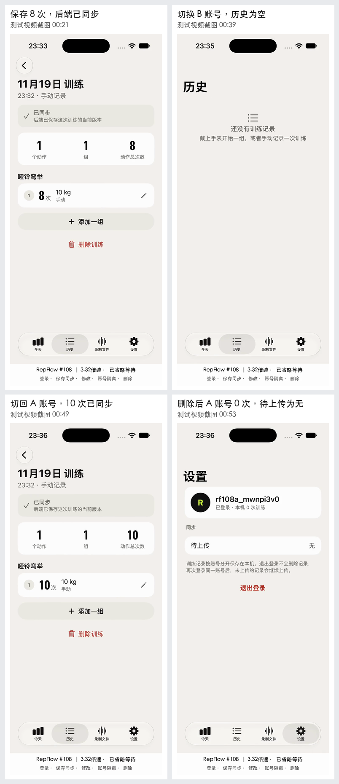

# 接口与功能测试结果（2026-11-19）

关联 [#108](https://github.com/Team-Party-A/repflow/issues/108)；依据[测试计划](测试计划.md)及冻结的 [OpenAPI 1.0.0](../api/openapi.yaml)。

**环境与方法**：11 月 19 日 23:30–23:40（Asia/Shanghai），通过 HTTPS 访问小组线上后端，启用正常 TLS 证书校验。iOS App 从 dev `50b27baf85962098d0a723efecac582a8a8207e9` 构建，运行于 Device Hub 的 iPhone 17 模拟器、iOS 27.0；后端部署源码版本未由本次黑盒测试单独核验。输入均为专用测试数据，不作为真实运动或算法准确率证据。

**结论**：下表所列子场景均通过，接口逐项检查 27/27 通过、失败 0 项，无新增功能缺陷。结果仅覆盖已执行的子场景，不代表整个测试计划全部通过。[接口逐项记录](接口与功能测试结果-2026-11-19.json)包含状态码、判定点和清理结果，不含服务器地址、密码或 token。

| 用例编号／本次子场景 | 操作与通过判定 | 实际结果 | 状态 |
| --- | --- | --- | --- |
| TC-ACC-001：注册、登录 | 注册专用账号；已有账号重新登录；重复用户名、错误密码分别拒绝 | App 注册后自动登录，已有账号两次登录成功；接口注册 201、登录 200、大小写重复用户名 409、错误密码 401，重新登录 user_id 不变 | 通过 |
| TC-IOS-001：手机保存、编辑、删除 | 手动录入哑铃弯举 8 次、10 kg；保存后查看历史及详情；改为 10 次；退出再登录后检查；删除 | 历史与详情显示已同步，详情总次数与组次数由 8 更新为 10；重新登录仍为 10；删除后历史为空、待上传为“无” | 通过 |
| TC-ACC-001：账号隔离 | A 保存一条训练后切换 B；接口用 B 查询、覆盖和删除 A 的记录 | B 的 App 历史为空；接口 B 查询 items 为空，跨账号 PUT／DELETE 均 404，未披露 current_revision | 通过 |
| TC-SYNC-001：在线上传、查询、重试 | 同一 ID、revision=1、8 次／10000 克重复 PUT，查询核对完整内容和数量 | 两次 PUT 均 200、回执版本 1；查询恰好一条，所有提交字段及组内容一致，无重复训练 | 通过 |
| TC-SYNC-002：版本冲突 | 同版本改成 10 次；提高到版本 2；重放版本 1；再查询 | 同版本不同内容及旧版 PUT 均 409、current_revision 正确；版本 2 写入 200，查询保留 10 次的完整新内容 | 通过 |
| TC-SYNC-002：删除及重放 | 先用旧版本删除，再以版本 3 删除并重试；旧版 DELETE、版本 4 PUT 尝试恢复 | 旧版删除 409；版本 3 删除及同版本重试均 200；旧删除重试 409、删除后 PUT 410；查询为空 | 通过 |
| TC-ACC-001：未登录访问、会话撤销 | 不带 token 查询／上传／删除；退出一个会话后再查询，同时保留另一独立会话 | 三类匿名请求均 401；退出 204，撤销 token 返回 401，另一会话仍可查询 200 | 通过 |
| TC-ACC-001／TC-SYNC-001／002：响应缓存 | 对上述 27 次接口响应检查 Cache-Control | 全部包含 no-store；API 明细分别为账号 14 项、在线同步 3 项、版本与删除 10 项 | 通过 |

**清理**：App 创建的 1 条训练已删除、A/B 均已退出；接口创建的 1 条训练已删除，清理查询为空，签发的 3 个接口会话均已撤销。4 个专用测试账号及最小删除标记保留，冻结契约无账号删除接口，[数据库设计](../design/数据库设计.md)也明确一期不提供物理删除。该方式与 [#98 后端自测清理记录](https://github.com/Team-Party-A/repflow/issues/98#issuecomment-6722461341)一致；请在 #108 验收时确认账号保留方式。账号清单仅在本地清理记录中保存。

**关键验证画面（原视频截图）**：

**视频证据**：[App 测试视频（55 秒）](../assets/issue-108-test-2026-11-19.mp4)随本报告提供：约 3.32 倍速，省略静止等待，保留登录、保存同步、修改、切换账号及删除的操作顺序；原片本地保留。视频仅覆盖 App 链路，27 项接口检查以明细 JSON 为证。最终验证使用已签名的模拟器构建。
